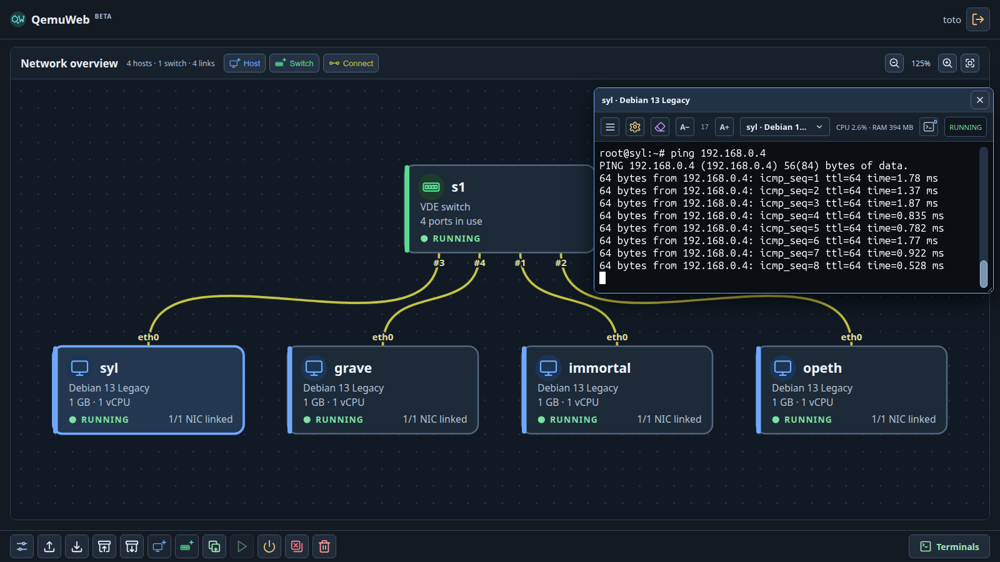
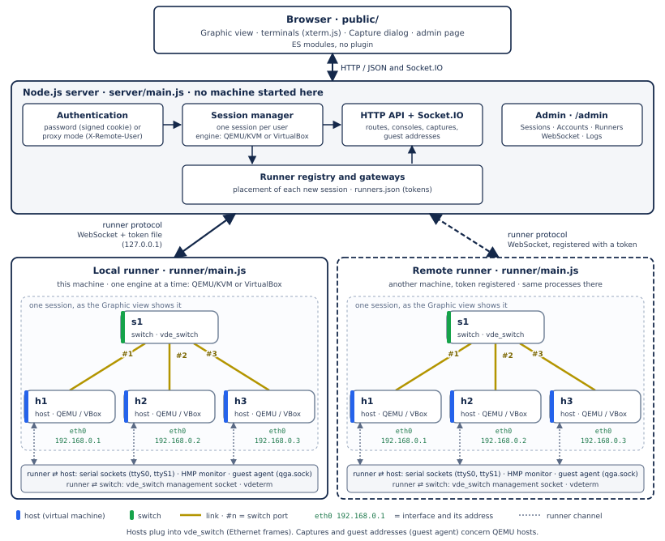

#  QemuWeb

QemuWeb is a web platform for **network labs**. Students create Linux machines (QEMU/KVM or VirtualBox), link
them with VDE switches and work on their serial consoles, all from a browser. Each student has one persistent
session; teachers observe it, take control to help, and clean up at the end of the lab.



## What it does

- **Hosts and switches in the browser**: draw a topology, start and stop machines, open their consoles (up to
  four at once, two serial ports per Debian host), the QEMU monitor and the logs.
- **Sessions you keep**: one per user, alive while the browser is closed; save or load a session as a ZIP
  archive, or a topology as a text file.
- **Startup scripts**: each host builds an ISO from its `start.sh` and configures itself at boot.
- **Teaching tools**: an admin page lists every session, observes a student read-only, takes control of a console
  with an exclusive lock, and deletes sessions in bulk; accounts are managed from the page or `scripts/user.sh`.
- **Local or remote runners**: machines run on the server or on other machines that dial in with a token.

## How it works



- The **server** (Node.js, Express, Socket.IO) serves the web interface, authenticates users, keeps one session
  per user and relays the consoles. It starts no machine.
- A **runner** runs the machines of the sessions placed on it: QEMU or VirtualBox, a `vde_switch` per switch,
  serial consoles over Unix sockets. The local runner dials the server on a Unix socket; a remote one opens an
  outbound WebSocket with its own token and needs no inbound port.
- The **browser** (ES modules, xterm.js, a network graph) needs no plugin.

More in [docs/architecture.md](docs/architecture.md).

## Try the demo

On **Ubuntu 24.04, x86-64**, with KVM (your user in the `kvm` group):

```sh
# tcpdump: live view of captures (optional to run, checked at startup like the other tools)
sudo apt install bash build-essential coreutils findutils grep gzip curl git python3 qemu-system-x86 qemu-utils genisoimage vde2 tcpdump
# Node.js 24 is required (Ubuntu's package is too old): nvm install, or sudo n 24
git clone https://github.com/orel33/qemuweb.git && cd qemuweb
npm ci
bash scripts/prepare.sh --system debian13-legacy      # downloads and builds the guest image
./scripts/demo.sh
```

Open <http://127.0.0.1:3003> and log in as `toto` (password `toto`; `tutu` and `admin` also exist, with the
password equal to the login). The demo loads `examples/lan.zip` and starts it: a switch and four hosts on
`192.168.0.x`. Open their consoles and `ping` between them. `Ctrl+C` stops everything. In the interface, the
**Load** button also lists the files of `examples/` (LAN, DMZ and gateway topologies and sessions).

If `qemu-system-x86_64 -netdev help` does not list `vde`, see
[QEMU without VDE support](docs/install.md#qemu-without-vde-support). To install QemuWeb for your own use, see
[docs/install.md](docs/install.md).

## Documentation

| Document | Content |
| --- | --- |
| [docs/install.md](docs/install.md) | Installation, starting the server and a runner, images, troubleshooting |
| [docs/user-guide.md](docs/user-guide.md) | Sessions, accounts, administration, topologies, startup scripts |
| [docs/reference.md](docs/reference.md) | Configuration files, command-line options, maintenance scripts, remote runner commands |
| [docs/deployment.md](docs/deployment.md) | Opening QemuWeb to students: nginx, TLS, services, remote runners, logs |
| [docs/architecture.md](docs/architecture.md) | Data paths between the browser, the server, QEMU and VDE |
| [docs/json-files.md](docs/json-files.md) | Specification of the JSON files |
| [docs/development.md](docs/development.md) | Code layout, tests, building the documentation |
| [docs/roadmap.md](docs/roadmap.md) | Roadmap to 1.0.0: milestones, tasks and open points |

PDF versions are in [docs/pdf/](docs/pdf/).

## Status

Version 0.9.3, beta. Until the hardening milestone (quotas, command restrictions, runner jail), give accounts
only to **trusted users**: any user can run any single-line QEMU monitor command on their own hosts.
