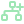

# QemuWeb v0.5.0

Guest startup ISO setup and existing-image upgrade: [Guest startup media](docs/guest-startup.md).

QemuWeb runs Alpine Linux, Debian 13 Cloud, Debian 13 Legacy, or OpenWrt in QEMU or VirtualBox and relays the `ttyS0` serial console to xterm.js through a local web server.

## Software architecture overview

QemuWeb is divided into three parts. The browser never connects directly to QEMU, VirtualBox, `vde_switch`, or their Unix sockets; all interactions go through `server.js`.

The two interactive terminal paths are the central architecture of the application. Components are separated by labelled links that show the transport used:

```text
VM console:
xterm.js ⇄[ Socket.IO over WS* ]⇄ server.js
         ⇄[ Unix serial socket · Node net.Socket ]⇄ QEMU/VirtualBox UART
         ⇄[ virtual serial port ]⇄ guest ttyS0

Switch terminal:
xterm.js ⇄[ Socket.IO over WS* ]⇄ server.js
         ⇄[ pseudo-terminal · node-pty ]⇄ vdeterm
         ⇄[ Unix management socket · -M ]⇄ vde_switch

QEMU monitor:
xterm.js monitor view ⇄[ HTTP/JSON ]⇄ Express/server.js
                     ⇄[ Unix monitor socket ]⇄ QEMU HMP

Actions and configuration:
Browser buttons ⇄[ HTTP/JSON ]⇄ Express/server.js
                →[ child_process spawn/exec ]→ QEMU/VBoxManage/vde_switch
```

The same paths, grouped by software location, are detailed below:

```text
┌─ BROWSER · public/index.html ─────────────────────────────────────────┐
│ Host tab:   System · Engine · NICs · Play/Resume · Stop · Reboot     │
│             Reset · Exit · Clear · Settings · Status                  │
│ Pane bar:   Session · Console/Monitor/Log view · Status                │
│ Switch tab: Play · Stop · Exit/Remove · Clear · Status                │
│ Shared interactive display: xterm.js                                 │
└───────────────────────────────────────────────────────────────────────┘
       │ HTTP/JSON: actions, configuration and QEMU monitor
       ↕ Socket.IO (WS*): consoles, switch terminal, logs and status
┌─ NODE.JS SERVER · server.js ──────────────────────────────────────────┐
│ Express API · sessions · process lifecycle · runtime files · buffers │
│ Host console:   Socket.IO ↔ serial relay using Node net.Socket       │
│ QEMU monitor:   HTTP request ↔ monitor Unix socket                   │
│ Switch console: Socket.IO ↔ terminal relay using node-pty            │
└───────────────────────────────────────────────────────────────────────┘
       │ child_process spawn/exec · Unix sockets · pseudo-terminal
       ▼
┌─ BACKEND · local external processes ──────────────────────────────────┐
│ QEMU VM:       qemu-system-x86_64 (KVM/TCG) · RAW → QCOW2            │
│                serial socket · HMP monitor · optional VDE NICs        │
│ VirtualBox VM: VBoxManage / VirtualBox · VDI → differential VDI      │
│                server-mode UART socket                               │
│ VDE switch:    vdeterm ↔ management socket (-M) ↔ vde_switch         │
│ VDE network:   QEMU NICs ↔ data socket (-s) ↔ vde_switch             │
└───────────────────────────────────────────────────────────────────────┘
```

\* Socket.IO uses WebSocket when available and can fall back to HTTP polling. It adds named events, session rooms and reconnection behavior on top of that transport.

`node-pty` is switch-specific. VM consoles already expose byte-oriented Unix serial sockets, so `server.js` relays them directly with Node's `net.Socket`; no pseudo-terminal is required. The VDE console instead runs `vdeterm`, a terminal application that needs the TTY semantics supplied by `node-pty` for prompts, editing, history, completion and resizing.

The engine changes the virtualization backend, disk implementation and available control channels:

| Engine | Execution and disk | Serial console | Monitor | VDE networking |
|---|---|---|---|---|
| **QEMU · KVM** | `qemu-system-x86_64` with hardware acceleration; QCOW2 working disk backed by RAW | QEMU Unix serial socket | QEMU HMP socket | Supported |
| **QEMU · TCG** | Same QEMU path with software CPU emulation; same QCOW2/RAW disk model | QEMU Unix serial socket | QEMU HMP socket | Supported |
| **VirtualBox** | `VBoxManage`; differential VDI working disk backed by the prepared VDI | VirtualBox server-mode UART socket | Not exposed by QemuWeb | Disabled in the current prototype |

KVM and TCG therefore share the same application architecture; only QEMU's acceleration mode changes. VirtualBox follows a different process and disk-management path, but converges on the same serial-console relay used by xterm.js.

The system selection does not introduce another software layer. It selects a declarative profile from `config.json`; the server combines that profile with QEMU defaults or VirtualBox settings:

| System profile | QEMU disk bus | QEMU network model | Memory | Architectural requirement |
|---|---|---|---:|---|
| **Alpine Linux 3.24** | VirtIO | `virtio-net-pci` | 512 MiB | Prepared boot and login on `ttyS0` |
| **Debian 13 Cloud** | VirtIO | `virtio-net-pci` | 1024 MiB | Prepared GRUB boot and login on `ttyS0` |
| **Debian 13 Legacy** | IDE | `e1000` | 1024 MiB | Legacy disk/NIC drivers; consoles on `tty0` and `ttyS0` |
| **OpenWrt 25.12** | VirtIO | `virtio-net-pci` | 256 MiB | Text shell on `ttyS0` |

Every profile provides a RAW base for QEMU and a prepared VDI base for VirtualBox. Its guest-side drivers and serial configuration must match the selected virtual hardware, but all systems use the same browser, API, session and console components.

The interactive paths are deliberately different because each endpoint provides a different interface:

| Interactive element | Data path | Purpose |
|---|---|---|
| QEMU VM console | `xterm.js ↔ Socket.IO ↔ server.js ↔ Unix serial socket ↔ QEMU UART ↔ guest ttyS0` | Display kernel output and provide the guest's `login:` prompt and shell. |
| VirtualBox VM console | `xterm.js ↔ Socket.IO ↔ server.js ↔ Unix serial socket ↔ VirtualBox UART ↔ guest ttyS0` | Provide the same guest console through VirtualBox's server-mode virtual UART. |
| VDE switch terminal | `xterm.js ↔ Socket.IO ↔ server.js ↔ node-pty ↔ vdeterm ↔ VDE management socket ↔ vde_switch` | Provide the interactive VDE prompt, including line editing, history, completion and asynchronous switch messages. |
| QEMU monitor | `xterm.js monitor view ↔ HTTP/JSON ↔ server.js ↔ Unix monitor socket ↔ QEMU HMP` | Send emulator commands such as `info status` in the same pane as the serial console; this controls QEMU and is not a guest shell. |
| Start, Stop, Reboot, Reset and Exit | `Toolbar ↔ HTTP/JSON ↔ server.js ↔ process/VBoxManage control` | Manage one VM or switch session and its working files. |
| Logs and status | `server.js ↔ Socket.IO ↔ selected browser tab` | Keep launch commands, process messages, console state and lifecycle state associated with the correct tab. |

VDE uses two separate paths:

```text
Interactive management:
xterm.js ↔ Socket.IO ↔ node-pty ↔ vdeterm ↔ management socket (-M) ↔ vde_switch

Virtual Ethernet traffic:
guest NIC ↔ QEMU -netdev vde ↔ VDE data socket (-s) ↔ vde_switch ↔ another guest NIC
```

The management path carries switch commands; it carries no guest network packets. Conversely, the VDE data socket transports Ethernet frames and is not a command console.

Offline image preparation is separate from runtime execution. `scripts/prepare.sh` and `scripts/prepare/` build reusable base images under `images/`. At runtime, `server.js` reads [config.json](config.json), creates per-session disks and Unix sockets under `runtime/`, and never modifies the base images. Current session state and bounded console transcripts are kept in server memory; working disks and sockets disappear when their session is deleted or the server performs its cleanup.

## Text console: xterm and the browser

In the historical QemuNet command, `-append '… console=ttyS0 …'` explicitly tells the **Linux kernel** to write to its first serial port. With `xterm -e qemu-system-x86_64 … -nographic`, QEMU hides the video display and, when no `-serial` option is supplied, implicitly connects that serial port to its standard input and output, and therefore to xterm. QEMU also shares those streams with its monitor (`Ctrl+A`, then `C`). The name `ttyS0` is not implicit: its **connection to xterm** is. A `getty` service on `ttyS0` is still needed to display a `login:` prompt.

In QemuWeb, `-display none` only hides the video display. `-serial unix:…` explicitly connects the serial port to a socket; the server then relays characters between that socket and xterm.js over WebSocket. `-monitor unix:…` opens a separate socket for the QEMU monitor. The serial console and login are configured in the images by `scripts/prepare.sh`. [The migration notes](docs/qemunet-to-qemuweb.md) describe both paths and the LAN migration.

### Serial console and QEMU monitor

Both options use the same short syntax here, but provide two distinct interfaces:

```sh
-serial unix:/path/to/console.sock,server=on,wait=off
-monitor unix:/path/to/monitor.sock,server=on,wait=off
```

`-serial` connects the first virtual serial port (`ttyS0` in Linux) to the guest's interactive terminal: boot messages, `login:`, and then a shell. `-monitor` opens the text-based HMP monitor of **QEMU itself**: its commands control the emulator and are not Linux shell commands. `server=on` makes QEMU listen on each Unix socket; the Node server connects to them. `wait=off` lets QEMU start without waiting for a connection. The short form of `-serial` replaces the earlier `-chardev socket,… -serial chardev:serial0` pair.

In the bar directly above each terminal, click the current view icon to choose **Console**, **Monitor**, or **Log** from a small menu. QEMU hosts offer all three views; VirtualBox hosts and VDE switches offer Console and Log. The **A−** and **A+** buttons change the font size of that terminal only (11–24 px); changing the font size in General Settings resets all terminal sizes to the new common value. The Log view is read-only, replays the session's existing history, and refreshes as new lines arrive or the server resets the log. In a QEMU host's **Monitor** view, for example, `help` lists commands, `info status` reports the VM's status, and `info block` describes its disks. Commands such as `system_reset` or `quit` directly change or stop the VM, so use them with care. Monitor commands and responses are recorded in the session Log even while that view is hidden.

## Image preparation

The main shell entrypoints (`start`, `stop`, `killall`, `cleanall`, `prepare`, and `run-tests`) are in `scripts/`. `scripts/prepare.sh` reads the IDs under `systems` in `config.json` and invokes the matching `scripts/prepare/<id>.sh` twice: first for sources in `sources/<id>/`, then for RAW/VDI images in `images/`. It prints both steps and their elapsed time, plus the total time for each system. `--list` shows each system's allocated RAW and VDI disk usage in decimal GB and the newest image modification date in local time. The shared shell functions are in `scripts/prepare/lib/`; the guest hook and Debian service file are in `scripts/prepare/resources/`. The rules shared by all four systems are collected in the [prepared image contract](docs/image-contract.md).

```sh
bash scripts/prepare.sh --help
bash scripts/prepare.sh --list
bash scripts/prepare.sh                 # all configured systems
bash scripts/prepare.sh --system debian13-legacy
bash scripts/prepare.sh --system debian13-legacy --force
```

Without `--force`, existing images are reused. `--force` warns, saves each old RAW/VDI pair in `images/backups/`, and replaces it with a rebuilt pair; if the build fails, it restores the old pair. It also runs while VMs are active, so stop affected hosts first when their working disks matter: an old differential disk may be incompatible with a rebuilt base. Each target keeps its downloads and checksums in `sources/<id>/`:

- **Alpine**: the script downloads and verifies the official `virt` ISO, installs it unattended into a RAW image, prepares the `root` and `toto` accounts, and adds `ifconfig` (`net-tools`), `ping` (`iputils-ping`), `ip`, `tcpdump`, `traceroute`, `dig`, `nc`, and `nano`. It configures boot output and login on `ttyS0`, then produces the VDI base for VirtualBox.
- **Debian 13 Cloud**: the script downloads and verifies the official cloud image, boots it once in an isolated temporary QEMU VM, prepares the `root` and `toto` accounts, and installs the Debian Legacy networking toolkit: `ifconfig` (`net-tools`), `ping` (`iputils-ping`), `tcpdump`, IP/bridge/VLAN/firewall tools, DNS and DHCP tools, scanning and VPN tools, and SSH/Telnet/FTP clients and servers. It also installs `nano`, `curl` and `wget`. Optional package recommendations are disabled. The script configures serial access and DHCP networking, disables cloud-init for subsequent boots, then produces a read-only RAW image. Rebuild an existing Cloud base with `bash scripts/prepare.sh --system debian13-cloud --force` to receive these packages; preserve its old base while any differential disk still depends on it.
- **Debian 13 Legacy**: a separate, compact teaching image installs the historical QemuNet network toolkit: IP, bridge, VLAN and firewall administration; DNS and DHCP clients/servers; capture, scanning and security tools including Scapy; SSH, Telnet, FTP and OpenVPN; Apache 2; Python and Expect; and small console utilities including `nano`. It boots from IDE with `root=/dev/sda1`, presents an `e1000` NIC, and enables consoles on `tty0` and `ttyS0`. Package recommendations are disabled so Scapy does not pull in IPython or graphical plotting tools. PHP, GCC, Emacs, TeX and TShark/Wireshark are intentionally omitted. Its complete construction and runtime contract is documented in the [Debian 13 Legacy image profile](docs/debian13-legacy.md).
- **OpenWrt**: the script verifies and decompresses the official RAW image, boots it once with a temporary WAN for package downloads, creates the `toto` account, persists the common hostname, and adds `tcpdump` and `nano`. The image's BusyBox supplies basic commands including `ifconfig`, `ping`, `ip`, `route`, `traceroute`, `nslookup`, and `nc`; preparation checks that all these tools are available before publishing the base.
- For **VirtualBox**, the script converts each RAW image into a read-only VDI base.

At launch, the server performs no further system configuration: QEMU creates a QCOW2 working disk based on the RAW image; VirtualBox creates a VDI working disk based on the prepared VDI. Each instance has its own writes. They are retained by **Stop**, **Play / Resume**, and **Reboot**, then discarded by **Reset**, **Exit**, or server shutdown. The base files in `images/` are never modified.

Each newly prepared RAW/VDI base has an empty `/etc/machine-id`. The Debian images also link `/var/lib/dbus/machine-id` to it, so systemd generates a distinct ID on the first boot of each host's working disk. Alpine and OpenWrt generate and save their ID in the guest startup hook because they do not use systemd. The ID then persists across reboots of that working disk. Existing images are reused unchanged; rebuild a system with `bash scripts/prepare.sh --system <sysname> --force` after stopping hosts that depend on its base to apply this rule.

`images/` contains ready-to-run base images named after the system identifier: `alpine.raw` / `alpine.vdi`, `debian13-cloud.raw` / `debian13-cloud.vdi`, `debian13-legacy.raw` / `debian13-legacy.vdi`, and `openwrt.raw` / `openwrt.vdi`. The `.raw` extension explicitly identifies the disk format. `sources/<id>/` keeps each target's downloads and checksums; `runtime/<session-id>/` separates files by server session; the 16-character hexadecimal session ID is independent of the server PID, and `session.json` records the session engine and its host and switch IDs. Each `h-<16 hex>` or `s-<16 hex>` ID is also the name of its runtime directory, which holds that object's configuration JSON alongside its sockets, ISO and working disk. The `hosts/<name>` and `switches/<name>` links point to those directories and follow renames; names needing filesystem escaping are URL encoded. A switch's management socket is named after the switch inside its runtime directory, so `vdeterm` displays a short named prompt without a second link; long names are shortened to fit the Unix socket path limit. [config.json](config.json) describes the systems and their launch options; preparation scripts read it but do not overwrite it.

`runtime/current` points to the most recently started regular server session; isolated integration-test servers do not replace it. `session.json` contains only the session's declarative engine and host/switch IDs. Process details stay outside the session directory in `runtime/server-<port>.pid` and `runtime/server-<port>.session`; neither belongs in a session archive. A normal shutdown removes these files, the current link and the empty session directory. At startup, the server also removes stale session directories containing only an empty `session.json`; directories with host or switch data remain available for inspection.

### System configuration

Command paths live in [`.env`](.env) (the tracked defaults) and `.env.local` (machine-specific overrides, ignored by Git), separate from [config.json](config.json). `.env` gives each command its default executable name, searched in `PATH`, for example `QEMU_SYSTEM_X86_64=qemu-system-x86_64`. To override one, put `NAME=/absolute/path/to/executable` in `.env.local`. A nonempty `.env.local` value takes priority over the process environment and `.env`. For example:

```sh
QEMU_SYSTEM_X86_64=/opt/qemu-11.1.3/bin/qemu-system-x86_64
```

At startup, the server checks the configured commands, prints a green check or red cross for each, and exits if any check fails. It uses the resolved QEMU, `qemu-img`, and `VBoxManage` paths. `npm start` still launches Node from `PATH`; image preparation and cleanup scripts also still use `PATH`.

[config.json](config.json) follows the same approach as [qemunet.cfg](https://github.com/orel33/qemunet/blob/master/qemunet.cfg): each key under `systems` (`alpine`, `debian13-cloud`, `debian13-legacy`, `openwrt`) identifies a system and its `scripts/prepare/<id>.sh` script. Each entry contains its `linux` type, `text` mode, label and long description, login details, `images.raw` and `images.vdi` paths, system-specific QEMU options, and VirtualBox settings. Paths can be relative to the project root or absolute. Launching relies on this file; `server.js` contains no rules tied to an OS name.

`session.defaults.engine` selects the initial engine for a new server session. `settings.defaults` supplies memory, processor count and hardware clock (`utc` or `localtime`), and `systems.<id>.settings` overrides these for a particular system. These three editable values belong only under `settings`: `qemu.defaults` and `systems.<id>.qemu` contain fixed QEMU profile values such as the read-only `q35` machine type, disk bus and NIC model. The server maps memory, processors and clock to QEMU `-m`, `-smp` and `-rtc base=…`, or to VirtualBox `--memory`, `--cpus` and `--rtcuseutc`. `systems.<id>.virtualbox` supplies the read-only VirtualBox guest OS type and disabled external networking. To add an already prepared Linux system in text mode, add a complete entry to `systems` with paths to its RAW and VDI bases; no separate catalog is needed.

In the web page, click **Host Settings** to view the selected host's system, resources, storage, network interfaces and corresponding QEMU or VirtualBox arguments. General, Hardware, Storage, Network, Startup and Expert have separate tabs in a fixed-height dialog; Storage begins with the disk bus, Network with the network card, and Startup shows the startup disk ISO path. The Startup tab displays read-only `@HOSTNAME@`, `@IFNAMEn@` and `@SWPORTn@` template values above the `start.sh` editor. New hosts with Ethernet 0 start with `hostname @HOSTNAME@` and `ifconfig @IFNAME0@ 192.168.0.@SWPORT0@/24`; the server replaces template values in a temporary copy when building the ISO and keeps the saved script unchanged. Changes remain in the dialog until **OK** saves `start.sh` under that host's `runtime/<session-id>/<host-id>/startup/` directory and updates startup options in `host.json`; **Cancel** discards them. **Add a new host** opens the same dialog under that title, with editable fields and **Start automatically**. The disk creation and launch commands are previewed in Expert. When launch settings change on a running host, OK asks whether to restart now or later; Cancel leaves the draft unsaved. The **Reset working disk at restart** checkbox sits below **Working disk (QCOW2 overlay)** for previously launched QEMU hosts. It can be saved without restarting immediately; the next Play or Reboot discards the working disk and starts from the base image. The checkbox is unavailable for new hosts and VirtualBox. The interface and system descriptions are in English.

The **QEMU · KVM / TCG / VirtualBox** choice is in **General Settings** and applies to the entire current application session. The server stores it in `runtime/<session-id>/session.json`. To change it, delete all hosts first; a different engine cannot silently apply to only later hosts. **QEMU · KVM** requires accessible `/dev/kvm` and fails with an error if KVM is unavailable or a VirtualBox VM is running. Select **QEMU · TCG** explicitly to use software emulation. Disk, serial-console, and monitor paths are generated at launch; the QCOW2 working disk format and control sockets are part of the application's operation. Each host's name, resources, interfaces and startup options live in its `host.json`; startup CD-ROM file contents live under its `startup/` directory. A pending one-time working disk reset stays in server memory and is returned by the Host Settings API, but is not saved in `host.json`. While a host runs, edited launch settings are saved for its next Play, Reboot or Reset; **Restart pending** marks this state. Reboot normally keeps the working disk; a pending reset discards it at the next Play or Reboot.

Every prepared base image starts with the internal hostname `qemuweb` and declares the lab credentials `root` with no password and `toto` / `toto`. A host name in the Web interface identifies its session; when the startup disk is enabled, the default `start.sh` also attempts to apply that name inside the guest. The image checks below record where this behavior still needs diagnosis.

### Stopping and cleaning up

Use `scripts/stop.sh` for a normal shutdown. It reads `runtime/server-<port>.pid` and signals only that QemuWeb server. The server writes this file and its separate `server-<port>.session` tracking file after it opens its port, whether started with `scripts/start.sh` or `npm start`, and removes them on exit. By default the port is 3002; set `PORT` to target another instance. If the PID no longer exists, `scripts/stop.sh` removes the stale tracking files; if it belongs to another process, the script refuses to signal it.

`Ctrl+C` sends `SIGINT` and `scripts/stop.sh` sends `SIGTERM`; QemuWeb handles both with the same graceful shutdown. This closes its hosts and switches and removes their temporary working disks. Use `scripts/killall.sh` only when you need to find and stop **all** project servers, including orphaned QEMU or VirtualBox instances.

```sh
./scripts/stop.sh                    # stop the tracked server on port 3002
PORT=3003 ./scripts/stop.sh          # stop the tracked server on port 3003
./scripts/killall.sh                 # emergency cleanup of all project servers and VMs
./scripts/cleanall.sh                # stop instances and empty runtime/; keep images/ and sources/
./scripts/cleanall.sh --images       # also empty images/; keep downloads in sources/
./scripts/cleanall.sh --sources      # also empty the sources/ download cache; keep the bases
./scripts/cleanall.sh --images --sources  # remove both the bases and the preparation cache
./scripts/cleanall.sh --dry-run      # show what would be stopped and removed
```

`scripts/cleanall.sh` calls the broader process cleanup and then removes the requested files. It keeps `.gitkeep` files and does not delete the code or `node_modules/`. After `--images`, `scripts/prepare.sh` can rebuild the bases from `sources/` without downloading them again; after `--sources`, a full preparation will need to download any missing sources.

### Formats in use

| Engine | Read-only base | Instance differential disk |
|---|---|---|
| QEMU | RAW | QCOW2 |
| VirtualBox | VDI converted from the same RAW image | Differential VDI |

The RAW image remains the master source. `scripts/prepare.sh` produces an additional VDI base for VirtualBox, which uses additional disk space. Both engines use the same OS content, but each creates its own working disk. The bases are never modified.

Technically, the **current disk** mentioned in the interface is a *differential disk*: a per-VM QCOW2 overlay for QEMU or a per-VM VDI differencing image for VirtualBox. It stores only the VM's writes and depends on its read-only base image. **Resume** and **Reboot** reopen that same disk; **Reset** replaces it with a new one.

### Conversions and commands

The following commands are equivalent to the steps performed by the project:

```sh
# Convert the RAW base to VDI for VirtualBox
qemu-img convert -f raw -O vdi base.raw base.vdi

# Create a QEMU working disk based on the RAW image
qemu-img create -f qcow2 -F raw -b base.raw instance.qcow2

# Create a VirtualBox differential disk based on the VDI
VBoxManage createmedium disk --filename instance.vdi --diffparent base.vdi --format VDI
```

VirtualBox can also convert the RAW image to VDI with `VBoxManage convertfromraw base.raw base.vdi --format VDI`. QEMU can use a VDI as the base of a QCOW2 by replacing `-F raw` with `-F vdi` in the overlay creation command. Neither variant is used by the application.

Preparation downloads missing images from official repositories and verifies them against the published checksums. Once the images are prepared, starting and running VMs requires no downloads or cloud service.

## Prerequisites

Linux x86_64 is required. The main dependencies on Debian/Ubuntu are:

| Purpose | Package or installation |
|---|---|
| Web server | `nodejs` (Node.js 18+), `npm` |
| QEMU virtual machines | `qemu-system-x86` or a custom QEMU build |
| Image overlays and conversion | `qemu-utils` (`qemu-img`) |
| Image preparation | `python3`; `genisoimage` for the Debian seed ISO |
| VDE LAN and interactive console | `vde2` (`vde_switch`, `vdeterm`); `node-pty` is installed by npm |
| VirtualBox VMs | VirtualBox installation (`VBoxManage`) |

KVM speeds up QEMU when `/dev/kvm` is accessible; otherwise TCG is available. The current startup check requires all eight configured commands, including `vde_switch` and `vdeterm` for VDE networking.

To compile QEMU with VDE support, run `./misc/install-qemu.sh /opt/`, then set its `bin/qemu-system-x86_64` path in `.env.local`. This build does not install `qemu-img`; use the separate `qemu-utils` package. See the [QEMU installer notes](misc/install-qemu.md) for the directory layout and build options.

## Installation and preparation

Install the standard command-line tools and the packages used for preparation and VDE networking:

```sh
sudo apt install bash coreutils findutils grep gzip curl nodejs npm python3 qemu-utils genisoimage vde2
```

Provide `qemu-system-x86_64` from `qemu-system-x86` or a custom build, and install VirtualBox to provide `VBoxManage` for the current startup check.

```sh
git clone --branch main https://github.com/orel33/qemuweb.git
cd qemuweb
npm ci
bash scripts/prepare.sh
```

Each `scripts/prepare/<id>.sh` places that system's downloaded sources in `sources/<id>/` and its final `<id>.raw` and `<id>.vdi` bases in `images/`. The orchestrator checks the selected systems' image paths declared in `config.json` but does not rewrite the file. The page's system menu is populated directly from `config.json`. `runtime/` is reserved for temporary preparation and VM files. These directories are ignored by Git, except for their `.gitkeep` files.

## Running QemuWeb

```sh
./start.sh
PORT=3003 ./start.sh  # launch another instance on port 3003
```

The root-level `start.sh` is a symbolic link to `scripts/start.sh`. It runs `npm start` in the foreground; `Ctrl+C` and `./scripts/stop.sh` can both end it. Open <http://127.0.0.1:3002>. Use the buttons at the bottom to add a host or a switch. **Add a new host** opens the Host Settings dialog titled **Add a new host**, with name, system, resources, network interfaces and Autostart; Cancel leaves no host behind, and OK creates it. The switch uses its own creation dialog. The engine is shown read-only in Host Settings. **General Settings** at the bottom left is its only selector for new hosts, including clones; QEMU/KVM is the default. It also sets the naming scheme for new hosts and switches: classic long (`host01`, `switch01`, ...; the default), classic (`h1`, `s1`, ...), French women's names from 1900, or Greek letters. Names from the French and Greek lists are selected at random without reusing an active name. The engine is saved on the server for the current session; naming and console appearance remain browser-local in `localStorage`. The name lists are in [naming-schemes.json](public/resources/naming-schemes.json). Existing hosts keep their names; all hosts in this application session share its engine. Use each pane's selector to open a session, then choose a view in the bar above that pane's terminal. Login details appear in Host Settings.

### Local VDE LAN prototype

The **Load topology** and **Save topology** buttons import `.topo` files and export the current sessions. Files contain `SWITCH name` and `HOST system-id name switch...` lines; `#` starts a comment. Switch names on a host line specify Ethernet interfaces in order. See `topo/lan.topo` and `topo/gw.topo`. Import validates the entire file, rejects unknown system IDs and displays the host and switch counts. Autostart is enabled by default and starts switches before hosts, using the engine in General Settings. The optional **Close previous sessions** deletes their working disks after validation. Connected interfaces require QEMU. Export rejects disconnected interfaces because this format cannot preserve their positions. Disk contents and runtime state are not saved.

New QEMU hosts start with one disconnected Ethernet card. In the **Network interfaces** section of **Host Settings**, use **+ Interface** to add up to four cards, remove unwanted cards, or select a VDE switch for each card. Changes saved while the host runs apply on its next Play, Reboot or Reset; no card is attached to the running guest immediately. A stopped switch must be started before its connected host can start. A new switch starts by default; if Autostart is unchecked, click **Play** to start `vde_switch` and its interactive `vdeterm` console in xterm.js. Commands such as `help` and `port/allprint`, command history, completion and asynchronous VDE messages use the persistent terminal session. Each card has its own MAC address; connected cards also receive a VDE port. Debian Legacy uses `e1000`, while Debian Cloud uses `virtio-net-pci`. Newly prepared images of both Debian profiles request `eth0`, `eth1`, and so on; older Cloud bases may still show names such as `enp0s2` (`ip link show` lists the actual names). Start two hosts against the same switch to make a LAN and configure IP addresses inside the guests. Host Settings shows the resulting QEMU launch arguments in Mode Expert.

Host Settings numbers cards from **Ethernet 0** in QEMU device order. This index is not a promise about the Linux name: both Debian image builders now set `net.ifnames=0`, while the kernel assigns `eth0`, `eth1`, and so on in discovery order. Rebuild an existing Debian Cloud base to apply this naming change; previous bases keep their original network names.

### Rebuilt image checks (QEMU/KVM)

The repeatable QEMU/KVM diagnostic passed on all four prepared systems, using two hosts per system on an isolated VDE switch:

| System | LAN interface | Root login without password | `hostname` | Ping both ways |
|---|---|---|---|---|
| Debian 13 Legacy | `eth0` | OK | OK | OK |
| Debian 13 Cloud | `eth0` | OK | OK | OK |
| Alpine | `eth0` | OK | OK | OK |
| OpenWrt (rebuilt) | `eth0`, no `br-lan` | OK after Enter | OK | OK |

On Debian 13 Cloud, the active hostname and `hostname -f` returned the new name, while `/etc/hostname` still contained the base name `qemuweb`. The diagnostic also captured ICMP requests and replies with `tcpdump` on both hosts of every system.

The previous OpenWrt image had no `hostname` command and used `br-lan` as its IP interface. Its preparation script now installs a small `hostname` get/set command when needed, removes the stock bridge and assigns the LAN directly to `eth0`. The RAW/VDI pair was rebuilt and the two-host KVM diagnostic passed. The old image's manual ping failure was also not reproduced when addresses were assigned to its former `br-lan` bridge.

Run `./scripts/run-tests.sh guest-network` to repeat the serial root login, interface, `hostname`, static LAN addressing, bidirectional ping and `tcpdump` checks on two guests of each system. It uses a separate server and working disks; details and profile selection are in [test/TESTS.md](test/TESTS.md).

For the guest kernel and image requirements behind the disk and NIC choices, see [QEMU guest buses and drivers](docs/qemu-guest-bus-and-drivers.md).

The **Debian 13 Cloud** profile uses a VirtIO disk and VirtIO network cards. **Debian 13 Legacy** is the separate IDE + `e1000` target, with `tty0`, `ttyS0`, and `root=/dev/sda1` configured by default.

An unchanged interface keeps its MAC address and VDE port across Stop and Resume. A saved interface change takes effect at the next start; a switch used by an active host cannot stop until that host stops or restarts with its new assignment. Before deleting a switch, remove all saved host connections and stop or restart any host still actively connected to it. Hot attachment to a running guest is planned in the [roadmap](docs/ROADMAP.md). Disconnected cards remain visible inside the guest but cannot exchange traffic. Removing every card creates a host without Ethernet; VirtualBox also has no network adapter. QEMU's `-nic none` disables its implicit network adapter; the explicit `-device e1000` or `-device virtio-net-pci` options still create the selected cards. This prototype creates no external network connection.

**QEMU · KVM** uses hardware acceleration and reports an error if `/dev/kvm` is missing or inaccessible, or if a VirtualBox host is running. Choose **QEMU · TCG** explicitly to use slower software emulation or to run QEMU alongside VirtualBox. VirtualBox cannot start while a QEMU host uses KVM; stop that host or start it with TCG first.

By default, [config.json](config.json) selects `-cpu host` in KVM mode: QEMU exposes the CPU features that the host can provide to the VM. This avoids the `CPUID.80000001H:ECX.svm` warning that QEMU's default CPU model can produce on an Intel host: `svm` is the AMD virtualization feature and is not needed for these VMs. In TCG mode, the profile selects `-cpu qemu64`. This setting affects the virtual CPU, not the Debian image; VMs already running keep their configuration until their next launch.

- **Alpine Linux 3.24**: `root` with an empty password, or `toto` / `toto`; temporary working disk.
- **Debian 13 Cloud**: `root` with no password, or `toto` / `toto`; temporary working disk.
- **Debian 13 Legacy**: `root` with no password, or `toto` / `toto`; temporary working disk.
- **OpenWrt 25.12 x86-64**: press Enter to open the `root` shell without a password; the secondary account is `toto` / `toto`; temporary working disk.

### Host and switch actions

The top-right **Graphic** button opens an overview of the current network. It shows hosts, switches, their state, and one curved link per connected Ethernet interface, labeled with its interface and switch port. Drag a host or switch to rearrange the view; links follow the nodes. These positions last for the current browser session and do not change the `.topo` file or network connections. The magnifier buttons zoom the whole graph in or out. Click a node to return to **Terminals** with that session selected. The top-right **Terminals** button also returns without changing running sessions.

The icons come from [Lucide](https://lucide.dev/icons); their license is kept in [public/icons/LICENSE-lucide.txt](public/icons/LICENSE-lucide.txt). The README uses small, locally stored SVGs in `docs/icons/`, colored to match the interface. Click the framed Host or Switch icon at the left of a terminal to open its action menu. Host Settings and Clear console sit beside that menu. General Settings is the first button in the bottom bar, and Exit All is the last button before the page controls. Actions in a terminal apply to its own session.

| Icon / control | Action | Menu label or hint | Effect |
|---|---|---|---|
|  | **Play** | `Play` | Create a new working disk and boot the host. |
|  | **Resume** | `Resume` | After Stop or a guest shutdown, boot from the same disk with the original system and engine, using the host's latest saved settings. This is a cold boot, not a saved-memory restore. |
|  | **Stop** | `Stop` | Request guest shutdown through QEMU's `system_powerdown` or VirtualBox's ACPI power button. If the guest does not stop within 10 seconds, force it off. Keep its disk, tab, logs, and display name. |
|  | **Reboot** | `Reboot` | Stop and boot again from the same disk with the latest saved settings. Use the same forced-stop fallback if needed. Keep the tab and display name. |
|  | **Reset** | `Reset` | After a QemuWeb warning dialog, stop the host, delete its current disk, create a fresh one from the base image, and boot with the latest saved settings. Keep the tab and display name. |
|  | **Exit** | `Exit` | After a QemuWeb warning dialog, force-stop the host, delete its disk, sockets, and logs, then close its tab. The red X on the tab asks for the same confirmation. |
| **Exit All** | **Exit all** | `Exit all hosts and switches` | After confirmation, close every host and switch and delete their working disks. |
|  | **Clear** | `Clear console` | Clear this tab's console history while preserving its current prompt or line. |
|  | **Host Settings** | `Host Settings` | Edit the selected host's launch settings and network interfaces; the Expert tab shows commands and technical details. |
|  | **General Settings** | `General Settings` | Choose the common engine for this application session before creating hosts, plus the browser-local automatic naming scheme and terminal appearance. |
|  | **New host** | `Add a new host` | Open Host Settings in creation mode, titled `Add a new host`; Autostart is selected by default. |
|  | **New switch** | `Add a new switch` | Open the VDE switch creation dialog; Autostart is selected by default. |
| **Console / Monitor / Log** menu | **Terminal view** | Current view icon | Reuse the same xterm area for the selected session's views. QEMU hosts provide all three; VirtualBox hosts and switches provide Console and read-only Log. |
| **A− / A+** | **Terminal font size** | `Decrease` / `Increase terminal font size` | Adjust only this terminal. General Settings can reset all terminals to a common size. |

A forced Stop can leave the guest filesystem needing repair on the next boot. Exit All affects every session.

### Host status

The badge in each terminal header describes that session:

| Status | Meaning |
|---|---|
| **NEW** | The tab has never started a host; no current disk exists. |
| **STARTING** | Play is creating or opening the disk and starting the host. |
| **RUNNING** | The host process is running. |
| **STOPPING** | Stop is waiting for graceful shutdown or applying its forced-stop fallback. |
| **STOPPED** | The host is off and its current disk is kept; Play resumes from that disk. |
| **REBOOTING** | The host is stopping and starting again on the same disk. |
| **RESETTING** | The current disk is being replaced and the host is starting from the base image. |
| **ERROR** | An action failed or the host ended with an error. The error message appears under the toolbar; the disk is retained when it still exists. |

Exit removes the tab, so it has no persistent status. Stopping the server with Ctrl+C force-stops its hosts and removes their temporary sessions and working disks.

Each host pane also shows **CPU** and **RAM** for its VM process on the server, refreshed about every two seconds. CPU uses one logical core as 100% and can exceed 100% for a multicore VM; RAM is the process's resident memory (RSS) in decimal MB. These are host-side consumption figures, not free memory or CPU load inside the guest. QEMU reads Linux `/proc`; VirtualBox uses `VBoxManage metrics`. A dash means the host is stopped, the first CPU sample is still pending, or a metric is unavailable. Switches have no VM metrics.

If port 3002 is already in use, stop the old server or choose another port:

```sh
PORT=3003 npm start
```

## Tests

Tests are organized under [`test/unit/`](test/unit/) and [`test/integration/`](test/integration/). [`test/TESTS.md`](test/TESTS.md) describes each test, its prerequisites, and its command. `npm test` runs only the unit tests; integration tests are selected separately because they boot prepared guest images.

Use `./scripts/run-tests.sh --list` to see the scenarios, then run one by name, for example `./scripts/run-tests.sh unit`, `./scripts/run-tests.sh lan2`, `./scripts/run-tests.sh lan4-startup`, or `./scripts/run-tests.sh gts16-profiles`. The LAN4 scenario checks four Debian 13 Legacy hosts configured automatically by `start.sh` template values and all pairwise ping paths. The runner prints a short description before starting each test. `./scripts/run-tests.sh web` starts the application on port 3003 for manual interface testing; set `PORT` to choose another port. To keep live output, use `./scripts/run-tests.sh lan4-startup 2>&1 | tee lan4-startup.log`.

## Official images

- [Alpine Linux virt](https://dl-cdn.alpinelinux.org/alpine/v3.24/releases/x86_64/)
- [Debian cloud images](https://cloud.debian.org/images/cloud/)
- [OpenWrt x86-64 images](https://downloads.openwrt.org/releases/25.12.6/targets/x86/64/)
