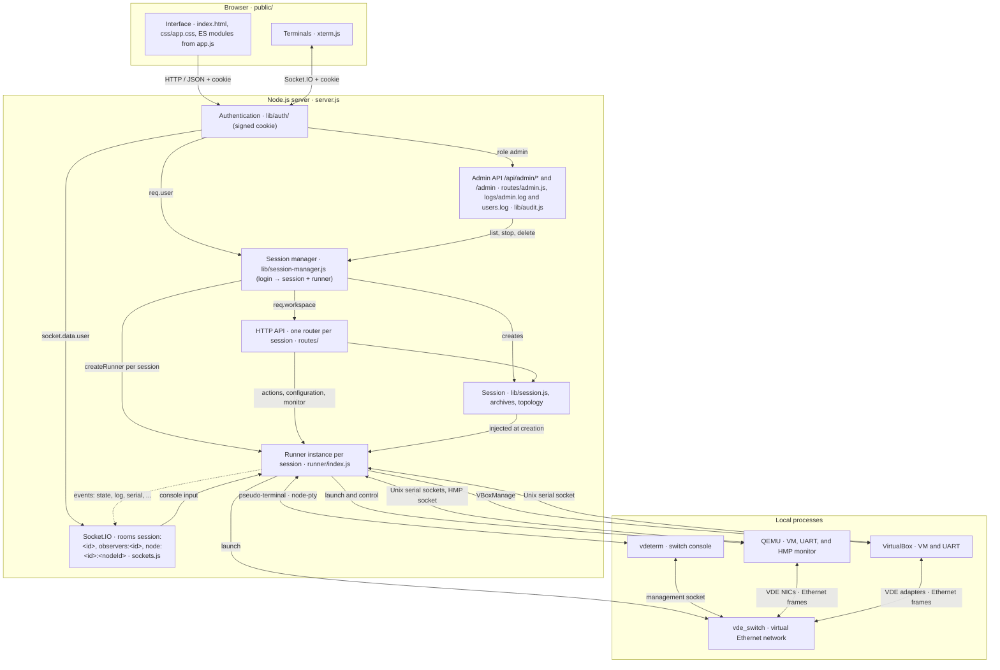

# QemuWeb architecture

QemuWeb separates the Web interface, the Node.js server, and local virtualization
processes. The browser communicates with the server, which creates the machines
and relays their consoles.

## Glossary

| Term | Meaning |
| --- | --- |
| Session | A user's workspace: its nodes, its engine (`qemu` or `vbox`), and its runtime directory `runtime/sessions/<id>/`. Each user owns exactly one session, with a random ID, recorded as `owner` in `meta.json` next to `session.json`. A session ZIP archive and `session.json` describe it; `meta.json` (owner, creation date) belongs to the live session only and is never exported. |
| User | A login from `users.json` (or the implicit `local` user when `QEMUWEB_AUTH=off`), with the role `student` or `admin`. An admin owns a session like anyone else and may also supervise, observe and clean up the others. |
| Observer | An admin's browser tab or socket reading another user's session (`X-Observe` header, Socket.IO `auth.observe`): read-only, except console input after taking control of a node. |
| Node | An element of a session: a host or a switch. API routes and Socket.IO events use `nodeId`. |
| Host | A node that is a virtual machine (QEMU or VirtualBox). |
| Switch | A node that is a VDE switch. |



## Main paths

- **Host console:** xterm.js exchanges characters with `sockets.js` over
  Socket.IO. The runner relays them through a QEMU or VirtualBox Unix serial
  socket connected to the guest's `ttyS0`.
- **Switch console:** Socket.IO connects to `node-pty`, which runs `vdeterm`.
  It uses the `vde_switch` management socket. Guest Ethernet traffic uses a
  separate VDE data socket.
- **QEMU monitor:** the Monitor view sends HTTP commands to the server; the
  runner queries QEMU's HMP socket. This controls the emulator, not the guest shell.
- **Actions and status:** the HTTP API asks the runner to start and stop
  processes. The runner reports state, logs and serial output as events, which
  `sockets.js` forwards over Socket.IO to the relevant browser tabs.
- **Users and sessions:** `lib/auth/` checks the signed cookie of every request
  and of the Socket.IO handshake (Origin checks are planned for milestone 6).
  `lib/session-manager.js` maps the login to its workspace `{session, runner}`,
  creating it at first use; it survives logouts and closed tabs until the user
  deletes it or the server stops. Each HTTP request goes to the router of the
  user's own session, so a node ID is looked up only there (404 otherwise).
  Per-session events go to the room `session:<id>`, per-node events to
  `node:<id>:<nodeId>`, which a socket joins only for a node of its own (or
  observed) session.
- **Administration:** `server.js` mounts, in this order after authentication,
  the observation gate (`X-Observe`: admins only, `GET`/`HEAD` only, the
  observed workspace taken with `manager.get`, never `open`), the
  `/api/admin` router (first middleware: role `admin`, then 403 on any path
  for others), `DELETE /api/session`, and the middleware that opens the
  caller's own session and records its activity. An admin call therefore never
  opens a session for the admin, and an observed session never gets an
  activity mark. An observer socket (`auth.observe`) joins the observed
  session's rooms and `observers:<id>`; `sockets.js` refuses its `input`,
  `clear-console` and `terminal-resize`, relays what the owner's page shows
  (`owner-view`, a [view state](#view-state) validated by `normalizeView`,
  published by that page whenever it changes, never derived from console
  sockets attaching; the last one is also sent to a new observer), sends `observe-unavailable` when the login has no session, and
  lets it type only while its admin controls the session (`take-control`
  from any of that admin's observer sockets, `lib/console-control.js`: one lock
  per session, held by the admin's login, released explicitly, after 10
  minutes without input, on session deletion, or when that admin's last
  observer socket on the session closes; the owner's input is then dropped on
  every node). `console-control` {admin, active} goes to every socket of the
  session, owner and observers, on each change and at connection, and the
  pages derive their banners from it only. While an admin holds
  control, the view goes the other way: the admin's page publishes
  `controller-view` (same fields and validation, accepted only from that admin
  while they hold a lock on the session, kept for a page opening meanwhile) and
  the owner's pages show it, with their own `owner-view` paused, so the two
  never drive each other at once. One driver at a time also in the browser:
  when a page's view is driven by the other side (the owner's page under
  control, or an observer with Follow checked and no control held),
  `body[data-view-driven]` disables every control that changes the view state
  (class `view-control`: view toggle, layout menu, switch consoles, paging,
  pane expand, tab selection, pane node menus), for the mouse (CSS) and the
  keyboard (`observe.js`); the banners say who drives. Every privileged socket
  event re-reads the account, so a disabled or removed account loses its
  sockets. `sockets.js` also counts each user's connected browser tabs (the
  tab's session socket carries `auth.main`), shown as online/offline in
  `/admin`. Admin actions are appended to `logs/admin.log`, the audit log of
  administrator actions (`lib/audit.js`).
- **User events:** `logs/users.log` receives logins and logouts from the
  `/auth` routes, session creation and deletion from the session manager
  events (`removed` carries who asked), and the owner's explicit node and
  archive actions from one middleware of the session router
  (`routes/index.js`, `userEvent`), written when the response is sent.
  `/admin` reads both logs from their end (`readLogTail`).

## View state

What a page of the workspace shows is one plain JSON object, the view state,
defined, validated and compared in one module, `public/view-state.js` (a
classic script shared by the server and the browser: `paneCount`,
`normalizeView(raw, nodeIds)`, `sameView`):

```text
{ mode:     'terminals' | 'graphic',
  layout:   'single' | 'columns-2' | 'rows-2' | 'grid-4',
  panes:    (nodeId | null)[],   exactly paneCount(layout) entries: the node shown in each
                                 pane, in pane order; null = empty pane
  expanded: null | integer,      the pane shown full-size, 0 <= expanded < panes.length
  switches: boolean,             switch consoles shown
  active:   nodeId | null }      the selected node (tab or graphic selection)
```

`normalizeView` returns a valid view state or null: known keys only (others
dropped), known layouts and modes, `panes` of the right length with strings or
null, `expanded` in range; node IDs not in the given list become null, and a
node shown in two panes is kept in the first one. The console page is not part
of the view: paging only decides which nodes are assigned to the panes, and
the resulting `panes` is what is published.

In the browser, `captureView()` reads the view and `applyView(view)` shows one
(layout, switch consoles, expanded pane, the panes' nodes through the same
assignment as the pane node menu, active node, mode), without saving it and
attaching only the consoles of panes whose node changes. `viewChanged()`, at
the end of `setPaneSessions` (so `showPage`), `focusPane` and
`setGraphicView`, publishes the view (deduplicated with `sameView`) and saves
it as `{view, graphicZoom}` in the browser; applying a received view does
neither. The owner's page publishes `owner-view`, except while an admin
controls its session; the controlling admin's page publishes
`controller-view`. A page follows a received view by `normalizeView` against
its own nodes, then `applyView`; a node it does not know yet makes it reload
its node list first. The saved view is restored the same way once the node
list is loaded.

## Module map

The server is split into layers with one-way dependencies:

- **`runner/`** manages node processes. It depends only on `common/`, Node
  built-ins and `node-pty`. The rest of the server requires only its facade
  `runner/index.js` (`createRunner`), called once per session: each runner
  receives its session by injection, has its own context (no module-level
  state), its own resource sampling timer, and reports `state`, `log`,
  `logs-reset`, `serial`, `serial-reset` and `nodes-removed` events through its
  own `EventEmitter`. Its modules are factories (`createCatalog(ctx)`, ...)
  attached to that context in dependency order.
- **`lib/`** is the control plane: `session-manager.js` (one session and one
  runner per user), `server-instance.js` (server records used by the scripts),
  `auth/` (authentication), and the session and what describes it:
  `session.js`, `session-snapshot.js` and `session-archive.js` (ZIP
  export/import), `topology.js` (`.topo` files).
- **`routes/`** and **`sockets.js`** form the web layer: HTTP routes by area and
  Socket.IO wiring. `server.js` only starts and wires everything.
- **`common/`** holds code shared by the runner and the server.

| Module | Role |
| --- | --- |
| `server.js` | Startup and wiring: HTTP server, Socket.IO, authentication, session manager and routes. |
| `sockets.js` | Forwards each runner's events to the rooms of its session, relays console input, and handles observer sockets and console control. |
| `routes/admin.js` | `/admin` page, `/api/admin/*` (sessions with metrics, stop-all, delete, bulk delete, accounts), the `X-Observe` observation gate. |
| `routes/index.js` | Builds the router of one session from the route modules; 404 for a node ID outside the session. |
| `routes/settings.js` | General settings, system catalog and startup CD-ROM capability. |
| `routes/nodes.js` | Node listing, switches, start, stop, Resume all, Stop all, reboot, reset, monitor, rename and deletion. |
| `routes/hosts.js` | Host creation, configuration and startup CD-ROM. |
| `routes/topology.js` | Topology (`.topo`) preview, creation and export. |
| `routes/archives.js` | Session ZIP size estimate, export, base image check and import. |
| `routes/metrics.js` | Per-host CPU and memory metrics. |
| `lib/session-manager.js` | Login → `{session, runner}`; creation at first use, deletion, shutdown, `runtime/users/<login>` links. |
| `lib/server-instance.js` | `runtime/server-<port>.pid` and `.session` records (read by `scripts/stop.sh`), pruning of empty sessions left by stopped servers. |
| `lib/auth/` | `index.js` facade (login routes, middleware, `requireAdmin`, Socket.IO handshake, `currentUser`), `users-store.js` (`users.json` and the account operations shared by `scripts/user.js` and the admin API), `passwords.js` (scrypt), `cookie.js` (signed cookie). |
| `lib/audit.js` | Log directory (`logs/` or `QEMUWEB_LOG_DIR`), `admin.log` (audit log of administrator actions) and `users.log` (user events), JSON lines, and reading their last entries. |
| `lib/console-control.js` | Exclusive per-session control lock (held by an admin's login) with its 10-minute idle timer. |
| `lib/session.js` | One session: engine, nodes, runtime directory, `session.json` (definition), `meta.json` (owner, creation date), and the last activity (memory only). |
| `lib/session-snapshot.js`, `lib/session-archive.js` | What a session ZIP contains, and the ZIP format itself. |
| `lib/topology.js` | `.topo` parsing and formatting. |
| `runner/index.js` | Runner facade and event list; `stopAllNodes` stops every host then every switch and keeps the nodes; `startAllNodes` starts every stopped switch then every stopped host (Resume all and the automatic start of a loaded session); both skip nodes with an action in progress. |
| `runner/context.js` | Per-runner context created by `createRunner`: session, commands, paths, `hostNodes()` of every session, events. |
| `runner/session-runtime.js` | Node records, runtime directories, hostname aliases, state and log publishing. |
| `runner/node-lifecycle.js` | Host start, stop, reboot, reset and deletion. |
| `runner/catalog.js`, `runner/host-config.js` | System catalog and `host.json`. |
| `runner/launch-preview.js` | Settings, storage paths and commands a host would use, without starting it. |
| `runner/engines/` | QEMU, QEMU monitor (HMP), VirtualBox, child process exit. |
| `runner/network/` | NIC MAC and port assignment; VDE switch and its `vdeterm` terminal. |
| `runner/console/` | Guest serial console and startup hook marker filtering. |
| `runner/media/` | Working disks, startup ISO, startup files and base image hashes. |
| `runner/preflight.js`, `runner/resources.js`, `runner/metrics.js` | Executable checks; CPU and memory sampling. |
| `common/` | IDs, launch settings, `config.json` validation, JSON writes, shell quoting. |

### Web interface

`public/index.html` contains only the page structure. `public/css/app.css`
holds the styles. The script is split into native ES modules (no framework or
bundler) loaded from `public/app.js`, which runs their initialization in a fixed
order. State that several modules reassign lives on the `store` object of
`state.js`. `monitor-terminal.js`, `session-log.js`, `network-node-icons.js`, `view-state.js` and
`topology-graphic.js` remain classic scripts, also loaded by unit tests.
`login.html` and its module `login.js` form the separate login page;
`admin.html` and `admin.js` the supervision page `/admin`, served to admins only.

| Module | Role |
| --- | --- |
| `app.js` | Entry point: initializes the other modules. |
| `account.js` | User name, Supervision link (admins), Delete session and Log out in the header; authentication-disabled warning. |
| `state.js` | Nodes, shared state, view and general settings in `localStorage`. |
| `api.js` | HTTP helpers: node URLs, JSON requests, launch preview URL, redirect to the login page on 401, `X-Observe` header in an observation tab. |
| `socket.js` | Per-pane console sockets and the shared notification socket. |
| `terminal.js` | Console panes, menus, font size and Console/Monitor/Log views. |
| `workspace.js` | Pane layout, paging, node tabs, state badges and metrics. |
| `nodes.js` | Node model, server synchronization and lifecycle actions. |
| `node-dialogs.js` | Add switch and Clone dialogs. |
| `host-settings.js` | Host Settings dialog, also used to add a host. |
| `startup-media.js` | Startup tab: `start.sh` template, startup disk and extra files. |
| `general-settings.js` | General Settings dialog. |
| `topology.js` | Graphic network view and `.topo` load/save. |
| `archive.js` | Session ZIP save and load dialogs. |
| `observe.js` | Observation tab (`/?observe=<login>`): target, socket options, banner and navigation, console control on both sides, following received view states. |
| `view-state.js` | Classic script, also required by `sockets.js`: the view state (`paneCount`, `normalizeView`, `sameView`). |

## Images and the session

[`config.json`](../config.json) defines system profiles and base image paths.
`scripts/prepare.sh` downloads and prepares those images in `images/`: RAW for
QEMU and VDI for VirtualBox. At runtime, each host gets its own working disk
under `runtime/sessions/<id>/` without changing the base image. QEMU uses a QCOW2
disk backed by RAW; VirtualBox uses a differential VDI. `session.json`,
`host.json`, `switch.json`, startup scripts, and sockets also live in `runtime/`.
`runtime/users/<login>` links to the user's session directory. The session ID
stays random and never contains the login, which keeps socket paths short and
logins out of archives.

Stopping a host keeps its working disk for a later start. Resetting recreates
the disk from the base image. Removing a node or stopping the server cleans
up its temporary files. A ZIP export can preserve a session explicitly; a
`.topo` file describes only hosts, switches, and their connections.

## Runner interface

Status: design of milestone 5a/5b (in progress). Until it is implemented, the
module map above describes the code.

The runner executes sessions; the control plane (web server) never touches a
node process, a node record or a runtime file. They talk through one
connection carrying a small message protocol, the same for the local runner
(Unix socket, 5b) and for remote runners (WebSocket over TLS, milestone 5c).
In 5a the protocol runs inside the server process over an in-memory duplex
stream pair; in 5b the runner is a separate process.

### Ownership

| Data | Owner |
| --- | --- |
| Node records (configuration, runtime state, run log, serial buffer, disks, startup files, launch settings, NIC assignment) | Runner (source of truth) |
| `runtime/sessions/<id>/`: `session.json`, `meta.json`, `host.json`, `switch.json`, `startup/`, working disks, sockets, hostname aliases | Runner |
| Session engine (`qemu`/`vbox`) | Runner (in `session.json`) |
| System catalog (`config.json`), executables, `/dev/kvm`, resource sampling | Runner |
| Login → session ID, owner, creation date, last activity, archive lock, HTTP routers, Socket.IO rooms, console control, view states, audit logs | Control plane |
| `runtime/users/<login>` alias, `runtime/server-<port>.*` records | Control plane (local filesystem only) |

The control plane keeps no copy of node records. Everything that reads or
changes a node (validation of a host configuration, topology loading, archive
installation, start/stop ordering) runs in the runner, as one command. A route
of `routes/` becomes: parse the HTTP request, send one command, map the result
or the error to the HTTP response. The runner's answers are exactly the JSON
bodies the routes return today.

### Transport and framing

One bidirectional byte stream: a Unix stream socket for the local runner. The
control plane listens on `runtime/runner-<port>.sock` (mode 0600) and the
runner connects to it, the same direction as a remote runner dialling out in
5c. Frames are length-prefixed:

```text
uint32 BE  length of what follows (1 + payload), at most 16 MiB
uint8      type: 0x4a 'J' = JSON message (UTF-8), 0x42 'B' = binary stream chunk
payload    J: one JSON object
           B: uint32 BE stream ID, then raw bytes (at most 1 MiB)
```

Length prefixes instead of newline-delimited JSON, because archives carry
binary data (QCOW2 disks up to 64 GiB): base64 in JSON would cost a third
more and a JSON parse per chunk. Each frame maps one-to-one to a WebSocket
text or binary message, so 5c changes the transport, not the protocol. No new
dependency: the codec is about 60 lines over `net`.

Console data stays JSON text: the runner already decodes serial and `vdeterm`
output as UTF-8 (`StringDecoder`), and browsers receive strings.

### Messages

```text
hello     runner -> CP, first message of every connection
          {type:'hello', protocol:1, pid, engines:['qemu'|'vbox'...],
           sessions:[{sessionId, engine, nodes:[<listNodes entry>...]}]}
request   CP -> runner  {type:'request', id, command, sessionId?, args}
response  runner -> CP  {type:'response', id, result}
                        {type:'response', id, error:{message, status?}}
event     runner -> CP  {type:'event', sessionId, event, payload}
input     CP -> runner  {type:'input', sessionId, nodeId, data}   no response
stream    either way    {type:'stream', id, op:'end'|'error'|'credit', message?, bytes?}
```

- `id` is a positive integer chosen by the sender of the request, unique on the
  connection; responses may arrive in any order. A request pending when the
  connection closes fails with "Runner connection lost.".
- `error.message` is the user-facing message the API returns today; `status`
  is the HTTP status when the runner decided it (unknown node 404, busy or
  non-empty session 409, start error 400/500); otherwise the route's default
  status applies.
- Every per-session command and event carries `sessionId`: one runner process
  serves every session of the machine (resource rules such as "no
  VirtualBox next to QEMU/KVM" and the 5c capacity limits span sessions).
- `input` (console keystrokes, at most 4096 characters, already checked by
  `sockets.js`) has no response, to keep typing latency at one write. Messages
  on one connection are handled in order, so input, resize and clear keep
  their order, and so do the events of a node.

### Commands

Session: `session.create {sessionId, owner, createdAt}` (directory,
`session.json`, `meta.json`), `session.delete` (destroy every node, remove the
directory), `session.settings` / `session.setEngine {engine}`,
`session.summary` (counts, running nodes, reserved RAM and CPU, for `/admin`),
`runner.shutdown` (every session, used at server stop).

Nodes (args mirror the HTTP bodies and queries): `nodes.list`,
`nodes.metrics`, `nodes.stopAll`, `nodes.startAll`, `nodes.deleteAll`,
`node.preview`, `node.start {nodeId, engine?, imageId?}`, `node.stop`,
`node.reboot`, `node.reset`, `node.monitor {command}`, `node.rename {name}`,
`node.delete`, `switch.create {id, name, autostart}`, `host.create {...}`,
`host.config` / `host.configure {...}`, `host.guestMedia` /
`host.setGuestMedia`, `host.buildGuestCdrom`, `host.attachGuestCdrom`.

Catalog and files: `catalog.systems`, `topology.preview {text, engine}`,
`topology.load {text, engine, autostart, closePrevious}`, `topology.export`,
`archive.estimate {includeDisks}`, `archive.check {engine, baseImages}`,
`archive.export {includeDisks}` (result `{stream, size}`, then the ZIP on that
stream), `archive.import {stream, autoStart, discardStaleDisks, declaredBytes}`
(the CP sends the uploaded ZIP on that stream; the result is the import
response).

Consoles: `console.attach {nodeId}` (the `node-snapshot` content: state, logs,
serial buffer), `console.resize {nodeId, cols, rows}`, `console.clear {nodeId,
line, column}`, and `input` messages.

### Events

`state`, `log`, `logs-reset`, `serial`, `serial-reset`, `nodes-removed`,
`nodes-changed`, `node-renamed` and `general-settings-changed`, with today's
Socket.IO payloads; `sockets.js` forwards them to the rooms of `sessionId`
(the last three were emitted by routes, they now come from the runner like the
others).

### Streams and backpressure

Archive transfers use binary frames on a stream ID allocated by the sender of
the request (`archive.import`) or by the runner (`archive.export`). Credit
flow control: a sender keeps at most 4 MiB unacknowledged per stream, the
receiver returns `credit` messages as it writes the bytes to disk or to the
HTTP response; `end` closes the stream, `error` aborts it, and so does the
connection loss. A transfer therefore never buffers more than 4 MiB in memory,
whatever the archive size.

Console output is coalesced per node and flushed once per event-loop turn. If
the connection's write buffer exceeds 8 MiB (a guest flooding its console),
the runner pauses the serial sockets and `vdeterm` terminals until the buffer
drains: the guest blocks on its UART instead of growing the server's memory.
Order is kept since nothing is dropped.

### Connection lifecycle (local runner, 5b)

1. `server.js` listens on `runtime/runner-<port>.sock`, then spawns
   `node runner/main.js <socket path>` as its child in its own process group
   (`detached`, so a terminal Ctrl+C reaches the server only).
2. The runner resolves its executables (`runner/preflight.js`), connects and
   sends `hello`. The server accepts one runner connection at a time, waits
   up to 10 s for `hello` (an executable missing: the runner's message is
   printed and the server exits), and starts listening for browsers only
   then.
3. On `hello`, the control plane resynchronises: a session it knows but the
   runner does not is gone, a session the runner reports but the control plane
   does not know is deleted with `session.delete`. On a fresh local runner both
   lists are empty; the same step serves the reconnection of remote runners.
4. Server stop (SIGINT, SIGTERM, `./scripts/stop.sh`): `runner.shutdown`
   destroys every node of every session and removes `runtime/sessions/<id>/`
   (as today), the runner exits, the server removes the socket and exits.
5. The runner treats the loss of its control connection as the end of its
   life: it destroys every node, removes its session directories and exits.
   A server killed with SIGKILL therefore leaves no VM behind.

**Runner death (proposed: the server fails).** If the runner process exits or
its connection drops while the server runs, the server logs it, kills the
runner's process group with SIGKILL (QEMU and `vde_switch` are in it;
`vdeterm` ends with its pseudo-terminal), removes the directories of its
sessions, and exits with status 1. This matches the decision "a server
restart erases everything" and leaves no half-alive session (browsers see the
server go away, as for any restart). The alternative, restarting the runner
and reopening every session empty, keeps logins alive but loses every node
anyway and needs browsers to reload: more code for no data kept. VirtualBox
VMs run under VBoxSVC, outside the process group: after a runner crash they
are left registered (as after a server crash today).

### Testing

- Unit: the frame codec (split and merged chunks, size limits, binary
  frames), the client (request/response matching, errors with status,
  connection loss failing pending requests, events), the dispatcher (unknown
  command, unknown session or node), stream credit; client and dispatcher
  connected through an in-memory duplex pair, no process. The existing runner
  unit tests drive the runner service directly.
- Boundaries: `runner/` requires only `runner/`, `common/`, built-ins and
  `node-pty`; the rest of the server reaches the runner only through the
  client (`lib/runner-client.js`) and never requires `runner/`, except
  `server.js` for the runner entry path.
- Integration: every existing scenario passes unchanged through the runner
  process. `check-runner` (VDE only) checks the runner process, a switch
  session through it, the effect of SIGKILL on the runner, and that no
  `vde_switch`/`qemu-system` process nor `runtime/sessions/<id>` remains.
