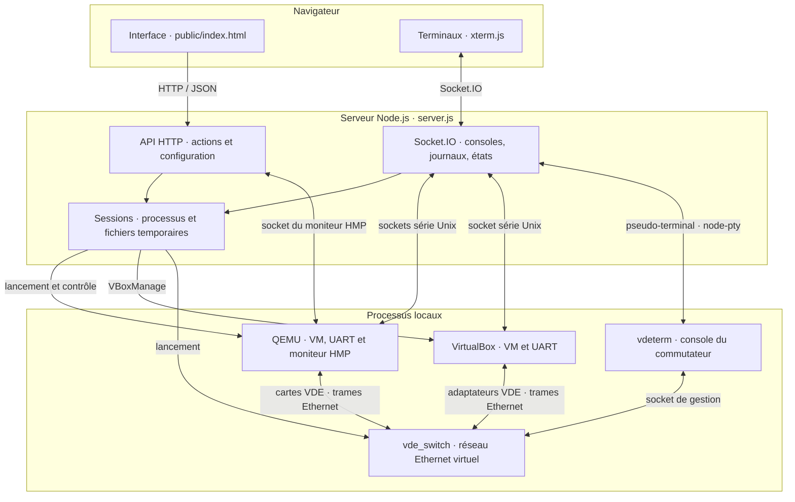

# Architecture de QemuWeb

QemuWeb sépare l'interface Web, le serveur Node.js et les processus de
virtualisation locaux. Le navigateur parle au serveur ; celui-ci crée les
machines et relaie leurs consoles.

## Flux principaux

- **Console d'un hôte :** xterm.js échange les caractères avec `server.js` par
  Socket.IO. Le serveur les relaie sur le socket série Unix de QEMU ou de
  VirtualBox, connecté au `ttyS0` de la machine invitée.
- **Console d'un commutateur :** Socket.IO mène à `node-pty`, qui héberge
  `vdeterm`. Celui-ci utilise le socket de gestion de `vde_switch`. Le trafic
  Ethernet des machines passe séparément par le socket de données VDE.
- **Moniteur QEMU :** la vue Monitor envoie des commandes HTTP au serveur, qui
  interroge le socket HMP de QEMU. Ce moniteur contrôle l'émulateur ; ce n'est
  pas un shell de la machine invitée.
- **Actions et états :** l'API HTTP démarre et arrête les processus. Socket.IO
  diffuse aux onglets les journaux, consoles et changements d'état.

## Images et sessions

[`config.json`](../config.json) définit les profils de systèmes et les chemins
des images de base. `scripts/prepare.sh` télécharge et prépare ces bases dans
`images/` : RAW pour QEMU, VDI pour VirtualBox. À l'exécution, chaque hôte possède
un disque de travail distinct sous `runtime/<session>/`, sans modifier sa base.
QEMU utilise un disque QCOW2 adossé au RAW ; VirtualBox utilise un VDI
différentiel. `session.json`, `host.json`, `switch.json`, les scripts de
démarrage et les sockets résident également dans `runtime/`.

Un arrêt d'hôte conserve son disque de travail pour une reprise. Une
réinitialisation le recrée depuis l'image de base. La suppression d'une session
ou l'arrêt du serveur nettoie ses fichiers temporaires. L'export ZIP permet de
conserver explicitement une session ; un fichier `.topo` ne décrit que les hôtes,
les commutateurs et leurs connexions.
