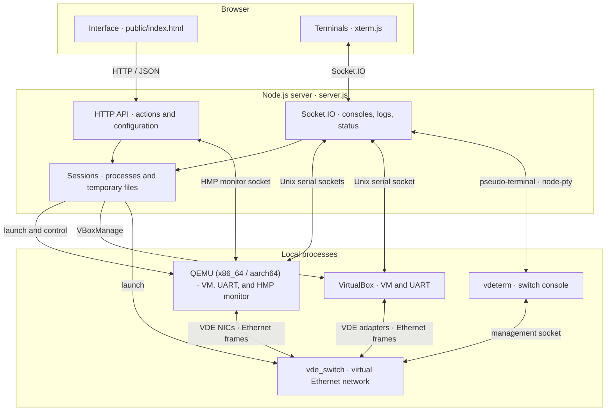

# QemuWeb architecture

QemuWeb separates the Web interface, the Node.js server, and local virtualization
processes. The browser communicates with the server, which creates the machines
and relays their consoles.



## Main paths

- **Host console:** xterm.js exchanges characters with `server.js` over
  Socket.IO. The server relays them through a QEMU or VirtualBox Unix serial
  socket connected to the guest's `ttyS0`.
- **Switch console:** Socket.IO connects to `node-pty`, which runs `vdeterm`.
  It uses the `vde_switch` management socket. Guest Ethernet traffic uses a
  separate VDE data socket.
- **QEMU monitor:** the Monitor view sends HTTP commands to the server, which
  queries QEMU's HMP socket. This controls the emulator, not the guest shell.
- **Actions and status:** the HTTP API starts and stops processes. Socket.IO
  sends logs, consoles, and status changes to the relevant browser tabs.

## Images and sessions

[`config.json`](../config.json) defines system profiles and base image paths.
`scripts/prepare.sh` downloads and prepares those images in `images/`: RAW for
QEMU and VDI for VirtualBox. At runtime, each host gets its own working disk
under `runtime/<session>/` without changing the base image. QEMU uses a QCOW2
disk backed by RAW; VirtualBox uses a differential VDI. `session.json`,
`host.json`, `switch.json`, startup scripts, and sockets also live in `runtime/`.

Stopping a host keeps its working disk for a later start. Resetting recreates
the disk from the base image. Removing a session or stopping the server cleans
up its temporary files. A ZIP export can preserve a session explicitly; a
`.topo` file describes only hosts, switches, and their connections.

## Virtualization backends and acceleration

QemuWeb dynamically inspects host virtualization capabilities to select the optimal acceleration mode:

| Host OS / Arch | Guest Arch | Engine Binary | Accelerator | CPU Model |
| --- | --- | --- | --- | --- |
| Linux x86_64 | x86_64 | `qemu-system-x86_64` | KVM (`-accel kvm`) | `host` |
| macOS x86_64 (Intel) | x86_64 | `qemu-system-x86_64` | HVF (`-accel hvf`) | `host` |
| macOS arm64 (Apple Silicon) | aarch64 | `qemu-system-aarch64` | HVF (`-accel hvf`) | `host` |
| macOS arm64 (Apple Silicon) | x86_64 | `qemu-system-x86_64` | TCG emulation (`-accel tcg`) | `max` |
| Any | Any | `qemu-system-*` (fallback) | TCG emulation (`-accel tcg`) | `max` / `qemu64` |

- System profiles define their architecture requirement via `arch:qemu` (`x86_64`, `aarch64`, or `auto`).
- When `arch:qemu` is `auto`, the engine automatically selects the native host architecture (`aarch64` on Apple Silicon, `x86_64` on Intel/AMD PCs) and the matching binary (`qemu-system-aarch64` or `qemu-system-x86_64`).
- VirtualBox (`VBoxManage`) remains supported as an optional alternative for x86_64 profiles when installed.

## Direct Kernel Boot and OCI Containers (Boot2container)

Boot2container (`container` system profile) allows booting virtual machines directly from OCI / Docker images without full OS disk images:

- **Direct Kernel Boot:** Rather than booting a disk image via SeaBIOS or UEFI, QEMU is launched with `-kernel` and `-initrd` pointing to a minimal Linux kernel and a Podman-enabled initramfs (`linux-arm64-qemu` / `linux-x86_64-qemu` and `initramfs.*.cpio.xz`).
- **Command-line arguments (`-append`):** The container runtime parameters are passed to the kernel:
  ```text
  console=ttyAMA0 console=ttyS0 b2c.cache_device=/dev/vda,use=existing|free-space b2c.run="-it <containerImage>"
  ```
- **Console relay:** Serial output is bound to the QEMU serial socket (`/dev/ttyAMA0` on ARM64 `virt`, `/dev/ttyS0` on x86_64 `q35`), enabling seamless interactive stdin/stdout relay to `xterm.js` over Socket.IO.
- **Persistent layer caching:** The session attaches `images/container.raw` as `/dev/vda`. Podman caches downloaded image layers on this disk, avoiding repeated downloads across VM restarts.
- **Dual networking:**
  - Interfaces set to `switchId: 'nat'` use QEMU SLIRP (`-netdev user`) to provide transparent DHCP, DNS, and Internet access for pulling container images without root/sudo privileges.
  - Interfaces assigned to a switch (`switchId: 's1'`, etc.) connect to VDE virtual switches (`-netdev vde`) for local virtual network topologies.
