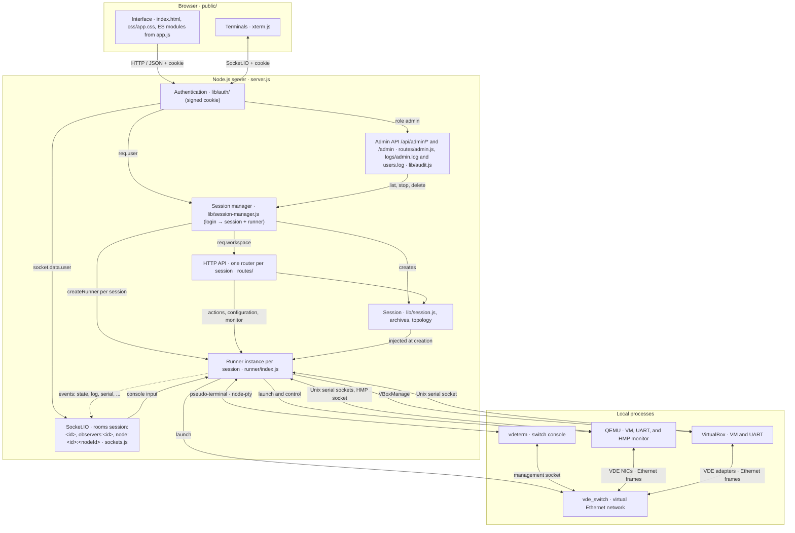

# QemuWeb architecture

QemuWeb separates the Web interface, the Node.js server, and local virtualization
processes. The browser communicates with the server, which creates the machines
and relays their consoles.

## Glossary

| Term | Meaning |
| --- | --- |
| Session | A user's workspace: its nodes, its engine (`qemu` or `vbox`), and its runtime directory `runtime/sessions/<id>/`. Each user owns exactly one session, with a random ID, recorded as `owner` in `meta.json` next to `session.json`. A session ZIP archive and `session.json` describe it; `meta.json` (owner, creation date) belongs to the live session only and is never exported. |
| User | A login from `users.json` (or the implicit `local` user when `QEMUWEB_AUTH=off`), with the role `student` or `admin`. An admin owns a session like anyone else and may also supervise, observe and clean up the others. |
| Observer | An admin's browser tab or socket reading another user's session (`X-Observe` header, Socket.IO `auth.observe`): read-only, except console input after taking control of a node. |
| Node | An element of a session: a host or a switch. API routes and Socket.IO events use `nodeId`. |
| Host | A node that is a virtual machine (QEMU or VirtualBox). |
| Switch | A node that is a VDE switch. |

## Main paths

- **Host console:** xterm.js exchanges characters with `sockets.js` over
  Socket.IO. The runner relays them through a QEMU or VirtualBox Unix serial
  socket connected to the guest's `ttyS0`.
- **Switch console:** Socket.IO connects to `node-pty`, which runs `vdeterm`.
  It uses the `vde_switch` management socket. Guest Ethernet traffic uses a
  separate VDE data socket.
- **QEMU monitor:** the Monitor view sends HTTP commands to the server; the
  runner queries QEMU's HMP socket. This controls the emulator, not the guest shell.
- **Actions and status:** the HTTP API asks the runner to start and stop
  processes. The runner reports state, logs and serial output as events, which
  `sockets.js` forwards over Socket.IO to the relevant browser tabs.
- **Users and sessions:** `lib/auth/` checks the signed cookie of every request
  and of the Socket.IO handshake (Origin checks are planned for milestone 6).
  `lib/session-manager.js` maps the login to its workspace `{session, runner}`,
  creating it at first use; it survives logouts and closed tabs until the user
  deletes it or the server stops. Each HTTP request goes to the router of the
  user's own session, so a node ID is looked up only there (404 otherwise).
  Per-session events go to the room `session:<id>`, per-node events to
  `node:<id>:<nodeId>`, which a socket joins only for a node of its own (or
  observed) session.
- **Administration:** `server.js` mounts, in this order after authentication,
  the observation gate (`X-Observe`: admins only, `GET`/`HEAD` only, the
  observed workspace taken with `manager.get`, never `open`), the
  `/api/admin` router (first middleware: role `admin`, then 403 on any path
  for others), `DELETE /api/session`, and the middleware that opens the
  caller's own session and records its activity. An admin call therefore never
  opens a session for the admin, and an observed session never gets an
  activity mark. An observer socket (`auth.observe`) joins the observed
  session's rooms and `observers:<id>`; `sockets.js` refuses its `input`,
  `clear-console` and `terminal-resize`, relays what the owner's page shows
  (`owner-view` {nodeId, mode, layout, panes, switches, page, expanded}: its
  active node, Terminals or Graphic, console layout (`single`, `columns-2`,
  `rows-2` or `grid-4`) and the node of each pane as assigned (also by the
  pane node menu), validated by `ownerViewOf`,
  published by that page when either changes, never derived from console
  sockets attaching; the last one is also sent to a new observer), sends `observe-unavailable` when the login has no session, and
  lets it type only while its admin controls the session (`take-control`
  from any of that admin's observer sockets, `lib/console-control.js`: one lock
  per session, held by the admin's login, released explicitly, after 10
  minutes without input, on session deletion, or when that admin's last
  observer socket on the session closes; the owner's input is then dropped on
  every node). `console-control` {admin, active} goes to every socket of the
  session, owner and observers, on each change and at connection, and the
  pages derive their banners from it only. While an admin holds
  control, the view goes the other way: the admin's page publishes
  `controller-view` (same fields and validation, accepted only from that admin
  while they hold a lock on the session, kept for a page opening meanwhile) and
  the owner's pages show it, with their layout controls disabled and their own
  `owner-view` paused, so the two never drive each other at once. Every privileged socket
  event re-reads the account, so a disabled or removed account loses its
  sockets. `sockets.js` also counts each user's connected browser tabs (the
  tab's session socket carries `auth.main`), shown as online/offline in
  `/admin`. Admin actions are appended to `logs/admin.log`, the audit log of
  administrator actions (`lib/audit.js`).
- **User events:** `logs/users.log` receives logins and logouts from the
  `/auth` routes, session creation and deletion from the session manager
  events (`removed` carries who asked), and the owner's explicit node and
  archive actions from one middleware of the session router
  (`routes/index.js`, `userEvent`), written when the response is sent.
  `/admin` reads both logs from their end (`readLogTail`).

## Module map

The server is split into layers with one-way dependencies:

- **`runner/`** manages node processes. It depends only on `common/`, Node
  built-ins and `node-pty`. The rest of the server requires only its facade
  `runner/index.js` (`createRunner`), called once per session: each runner
  receives its session by injection, has its own context (no module-level
  state), its own resource sampling timer, and reports `state`, `log`,
  `logs-reset`, `serial`, `serial-reset` and `nodes-removed` events through its
  own `EventEmitter`. Its modules are factories (`createCatalog(ctx)`, ...)
  attached to that context in dependency order.
- **`lib/`** is the control plane: `session-manager.js` (one session and one
  runner per user), `server-instance.js` (server records used by the scripts),
  `auth/` (authentication), and the session and what describes it:
  `session.js`, `session-snapshot.js` and `session-archive.js` (ZIP
  export/import), `topology.js` (`.topo` files).
- **`routes/`** and **`sockets.js`** form the web layer: HTTP routes by area and
  Socket.IO wiring. `server.js` only starts and wires everything.
- **`common/`** holds code shared by the runner and the server.

| Module | Role |
| --- | --- |
| `server.js` | Startup and wiring: HTTP server, Socket.IO, authentication, session manager and routes. |
| `sockets.js` | Forwards each runner's events to the rooms of its session, relays console input, and handles observer sockets and console control. |
| `routes/admin.js` | `/admin` page, `/api/admin/*` (sessions with metrics, stop-all, delete, bulk delete, accounts), the `X-Observe` observation gate. |
| `routes/index.js` | Builds the router of one session from the route modules; 404 for a node ID outside the session. |
| `routes/settings.js` | General settings, system catalog and startup CD-ROM capability. |
| `routes/nodes.js` | Node listing, switches, start, stop, reboot, reset, monitor, rename and deletion. |
| `routes/hosts.js` | Host creation, configuration and startup CD-ROM. |
| `routes/topology.js` | Topology (`.topo`) preview, creation and export. |
| `routes/archives.js` | Session ZIP size estimate, export, base image check and import. |
| `routes/metrics.js` | Per-host CPU and memory metrics. |
| `lib/session-manager.js` | Login → `{session, runner}`; creation at first use, deletion, shutdown, `runtime/users/<login>` links. |
| `lib/server-instance.js` | `runtime/server-<port>.pid` and `.session` records (read by `scripts/stop.sh`), pruning of empty sessions left by stopped servers. |
| `lib/auth/` | `index.js` facade (login routes, middleware, `requireAdmin`, Socket.IO handshake, `currentUser`), `users-store.js` (`users.json` and the account operations shared by `scripts/user.js` and the admin API), `passwords.js` (scrypt), `cookie.js` (signed cookie). |
| `lib/audit.js` | Log directory (`logs/` or `QEMUWEB_LOG_DIR`), `admin.log` (audit log of administrator actions) and `users.log` (user events), JSON lines, and reading their last entries. |
| `lib/console-control.js` | Exclusive per-session control lock (held by an admin's login) with its 10-minute idle timer. |
| `lib/session.js` | One session: engine, nodes, runtime directory, `session.json` (definition), `meta.json` (owner, creation date), and the last activity (memory only). |
| `lib/session-snapshot.js`, `lib/session-archive.js` | What a session ZIP contains, and the ZIP format itself. |
| `lib/topology.js` | `.topo` parsing and formatting. |
| `runner/index.js` | Runner facade and event list; `stopAllNodes` stops every host then every switch and keeps the nodes. |
| `runner/context.js` | Per-runner context created by `createRunner`: session, commands, paths, `hostNodes()` of every session, events. |
| `runner/session-runtime.js` | Node records, runtime directories, hostname aliases, state and log publishing. |
| `runner/node-lifecycle.js` | Host start, stop, reboot, reset and deletion. |
| `runner/catalog.js`, `runner/host-config.js` | System catalog and `host.json`. |
| `runner/launch-preview.js` | Settings, storage paths and commands a host would use, without starting it. |
| `runner/engines/` | QEMU, QEMU monitor (HMP), VirtualBox, child process exit. |
| `runner/network/` | NIC MAC and port assignment; VDE switch and its `vdeterm` terminal. |
| `runner/console/` | Guest serial console and startup hook marker filtering. |
| `runner/media/` | Working disks, startup ISO, startup files and base image hashes. |
| `runner/preflight.js`, `runner/resources.js`, `runner/metrics.js` | Executable checks; CPU and memory sampling. |
| `common/` | IDs, launch settings, `config.json` validation, JSON writes, shell quoting. |

### Web interface

`public/index.html` contains only the page structure. `public/css/app.css`
holds the styles. The script is split into native ES modules (no framework or
bundler) loaded from `public/app.js`, which runs their initialization in a fixed
order. State that several modules reassign lives on the `store` object of
`state.js`. `monitor-terminal.js`, `session-log.js`, `network-node-icons.js` and
`topology-graphic.js` remain classic scripts, also loaded by unit tests.
`login.html` and its module `login.js` form the separate login page;
`admin.html` and `admin.js` the supervision page `/admin`, served to admins only.

| Module | Role |
| --- | --- |
| `app.js` | Entry point: initializes the other modules. |
| `account.js` | User name, Supervision link (admins), Delete session and Log out in the header; authentication-disabled warning. |
| `state.js` | Nodes, shared state, view and general settings in `localStorage`. |
| `api.js` | HTTP helpers: node URLs, JSON requests, launch preview URL, redirect to the login page on 401, `X-Observe` header in an observation tab. |
| `socket.js` | Per-pane console sockets and the shared notification socket. |
| `terminal.js` | Console panes, menus, font size and Console/Monitor/Log views. |
| `workspace.js` | Pane layout, paging, node tabs, state badges and metrics. |
| `nodes.js` | Node model, server synchronization and lifecycle actions. |
| `node-dialogs.js` | Add switch and Clone dialogs. |
| `host-settings.js` | Host Settings dialog, also used to add a host. |
| `startup-media.js` | Startup tab: `start.sh` template, startup disk and extra files. |
| `general-settings.js` | General Settings dialog. |
| `topology.js` | Graphic network view and `.topo` load/save. |
| `archive.js` | Session ZIP save and load dialogs. |
| `observe.js` | Observation tab (`/?observe=<login>`): target, socket options, banner and navigation, console control on both sides. |

## Images and the session

[`config.json`](../config.json) defines system profiles and base image paths.
`scripts/prepare.sh` downloads and prepares those images in `images/`: RAW for
QEMU and VDI for VirtualBox. At runtime, each host gets its own working disk
under `runtime/sessions/<id>/` without changing the base image. QEMU uses a QCOW2
disk backed by RAW; VirtualBox uses a differential VDI. `session.json`,
`host.json`, `switch.json`, startup scripts, and sockets also live in `runtime/`.
`runtime/users/<login>` links to the user's session directory. The session ID
stays random and never contains the login, which keeps socket paths short and
logins out of archives.

Stopping a host keeps its working disk for a later start. Resetting recreates
the disk from the base image. Removing a node or stopping the server cleans
up its temporary files. A ZIP export can preserve a session explicitly; a
`.topo` file describes only hosts, switches, and their connections.
