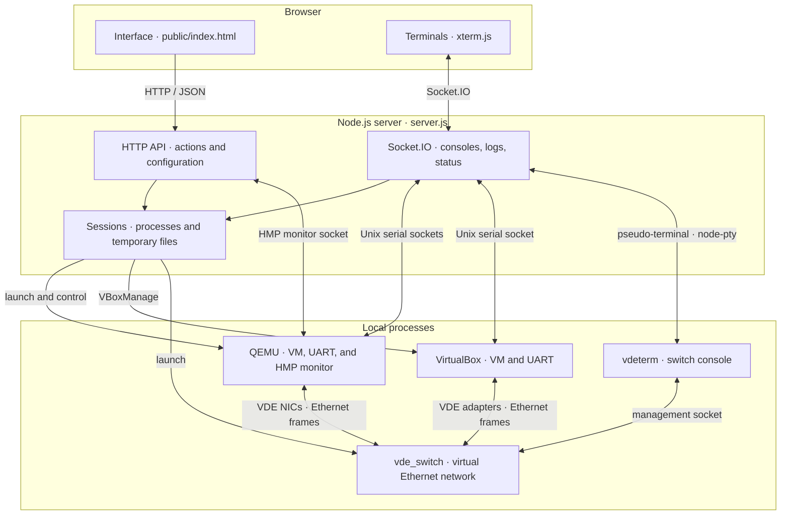

# QemuWeb architecture

QemuWeb separates the Web interface, the Node.js server, and local virtualization
processes. The browser communicates with the server, which creates the machines
and relays their consoles.

## Main paths

- **Host console:** xterm.js exchanges characters with `server.js` over
  Socket.IO. The server relays them through a QEMU or VirtualBox Unix serial
  socket connected to the guest's `ttyS0`.
- **Switch console:** Socket.IO connects to `node-pty`, which runs `vdeterm`.
  It uses the `vde_switch` management socket. Guest Ethernet traffic uses a
  separate VDE data socket.
- **QEMU monitor:** the Monitor view sends HTTP commands to the server, which
  queries QEMU's HMP socket. This controls the emulator, not the guest shell.
- **Actions and status:** the HTTP API starts and stops processes. Socket.IO
  sends logs, consoles, and status changes to the relevant browser tabs.

## Images and sessions

[`config.json`](../config.json) defines system profiles and base image paths.
`scripts/prepare.sh` downloads and prepares those images in `images/`: RAW for
QEMU and VDI for VirtualBox. At runtime, each host gets its own working disk
under `runtime/<session>/` without changing the base image. QEMU uses a QCOW2
disk backed by RAW; VirtualBox uses a differential VDI. `session.json`,
`host.json`, `switch.json`, startup scripts, and sockets also live in `runtime/`.

Stopping a host keeps its working disk for a later start. Resetting recreates
the disk from the base image. Removing a session or stopping the server cleans
up its temporary files. A ZIP export can preserve a session explicitly; a
`.topo` file describes only hosts, switches, and their connections.
