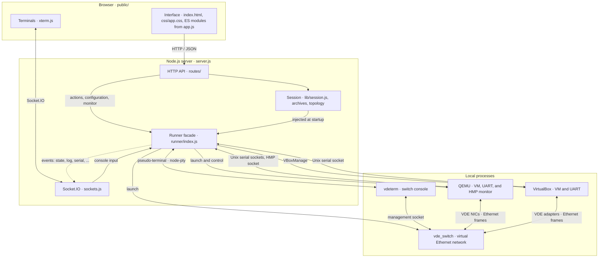

# QemuWeb architecture

QemuWeb separates the Web interface, the Node.js server, and local virtualization
processes. The browser communicates with the server, which creates the machines
and relays their consoles.

## Glossary

| Term | Meaning |
| --- | --- |
| Session | The workspace of QemuWeb: its nodes, its engine (`qemu` or `vbox`), and its runtime directory `runtime/sessions/<id>/`. The server currently holds one session. A session ZIP archive and `session.json` describe it. |
| Node | An element of a session: a host or a switch. API routes and Socket.IO events use `nodeId`. |
| Host | A node that is a virtual machine (QEMU or VirtualBox). |
| Switch | A node that is a VDE switch. |

## Main paths

- **Host console:** xterm.js exchanges characters with `sockets.js` over
  Socket.IO. The runner relays them through a QEMU or VirtualBox Unix serial
  socket connected to the guest's `ttyS0`.
- **Switch console:** Socket.IO connects to `node-pty`, which runs `vdeterm`.
  It uses the `vde_switch` management socket. Guest Ethernet traffic uses a
  separate VDE data socket.
- **QEMU monitor:** the Monitor view sends HTTP commands to the server; the
  runner queries QEMU's HMP socket. This controls the emulator, not the guest shell.
- **Actions and status:** the HTTP API asks the runner to start and stop
  processes. The runner reports state, logs and serial output as events, which
  `sockets.js` forwards over Socket.IO to the relevant browser tabs.

## Module map

The server is split into layers with one-way dependencies:

- **`runner/`** manages node processes. It depends only on `common/`, Node
  built-ins and `node-pty`. The rest of the server requires only its facade
  `runner/index.js` (`createRunner`), which receives the session by injection
  and reports `state`, `log`, `logs-reset`, `serial`, `serial-reset` and
  `nodes-removed` events through an `EventEmitter`.
- **`lib/`** holds the session and what describes it: `session.js`,
  `session-snapshot.js` and `session-archive.js` (ZIP export/import),
  `topology.js` (`.topo` files).
- **`routes/`** and **`sockets.js`** form the web layer: HTTP routes by area and
  Socket.IO wiring. `server.js` only starts and wires everything.
- **`common/`** holds code shared by the runner and the server.

| Module | Role |
| --- | --- |
| `server.js` | Startup and wiring: HTTP server, Socket.IO, session, runner and routes. |
| `sockets.js` | Forwards runner events to browsers and relays console input. |
| `routes/settings.js` | General settings, system catalog and startup CD-ROM capability. |
| `routes/nodes.js` | Node listing, switches, start, stop, reboot, reset, monitor, rename and deletion. |
| `routes/hosts.js` | Host creation, configuration and startup CD-ROM. |
| `routes/topology.js` | Topology (`.topo`) preview, creation and export. |
| `routes/archives.js` | Session ZIP size estimate, export, base image check and import. |
| `routes/metrics.js` | Per-host CPU and memory metrics. |
| `lib/session.js` | The session: engine, nodes, runtime directory and `session.json`. |
| `lib/session-snapshot.js`, `lib/session-archive.js` | What a session ZIP contains, and the ZIP format itself. |
| `lib/topology.js` | `.topo` parsing and formatting. |
| `runner/index.js` | Runner facade and event list. |
| `runner/context.js` | Context injected by `createRunner`: session, commands, paths, events. |
| `runner/session-runtime.js` | Node records, runtime directories, hostname aliases, state and log publishing. |
| `runner/node-lifecycle.js` | Host start, stop, reboot, reset and deletion. |
| `runner/catalog.js`, `runner/host-config.js` | System catalog and `host.json`. |
| `runner/launch-preview.js` | Settings, storage paths and commands a host would use, without starting it. |
| `runner/engines/` | QEMU, QEMU monitor (HMP), VirtualBox, child process exit. |
| `runner/network/` | NIC MAC and port assignment; VDE switch and its `vdeterm` terminal. |
| `runner/console/` | Guest serial console and startup hook marker filtering. |
| `runner/media/` | Working disks, startup ISO, startup files and base image hashes. |
| `runner/preflight.js`, `runner/resources.js`, `runner/metrics.js` | Executable checks; CPU and memory sampling. |
| `common/` | IDs, launch settings, `config.json` validation, JSON writes, shell quoting. |

### Web interface

`public/index.html` contains only the page structure. `public/css/app.css`
holds the styles. The script is split into native ES modules (no framework or
bundler) loaded from `public/app.js`, which runs their initialization in a fixed
order. State that several modules reassign lives on the `store` object of
`state.js`. `monitor-terminal.js`, `session-log.js`, `network-node-icons.js` and
`topology-graphic.js` remain classic scripts, also loaded by unit tests.

| Module | Role |
| --- | --- |
| `app.js` | Entry point: initializes the other modules. |
| `state.js` | Nodes, shared state, view and general settings in `localStorage`. |
| `api.js` | HTTP helpers: node URLs, JSON requests, launch preview URL. |
| `socket.js` | Per-pane console sockets and the shared notification socket. |
| `terminal.js` | Console panes, menus, font size and Console/Monitor/Log views. |
| `workspace.js` | Pane layout, paging, node tabs, state badges and metrics. |
| `nodes.js` | Node model, server synchronization and lifecycle actions. |
| `node-dialogs.js` | Add switch and Clone dialogs. |
| `host-settings.js` | Host Settings dialog, also used to add a host. |
| `startup-media.js` | Startup tab: `start.sh` template, startup disk and extra files. |
| `general-settings.js` | General Settings dialog. |
| `topology.js` | Graphic network view and `.topo` load/save. |
| `archive.js` | Session ZIP save and load dialogs. |

## Images and the session

[`config.json`](../config.json) defines system profiles and base image paths.
`scripts/prepare.sh` downloads and prepares those images in `images/`: RAW for
QEMU and VDI for VirtualBox. At runtime, each host gets its own working disk
under `runtime/sessions/<id>/` without changing the base image. QEMU uses a QCOW2
disk backed by RAW; VirtualBox uses a differential VDI. `session.json`,
`host.json`, `switch.json`, startup scripts, and sockets also live in `runtime/`.

Stopping a host keeps its working disk for a later start. Resetting recreates
the disk from the base image. Removing a node or stopping the server cleans
up its temporary files. A ZIP export can preserve a session explicitly; a
`.topo` file describes only hosts, switches, and their connections.
