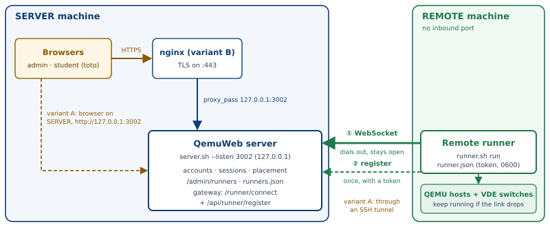

# Remote runner test sheet

QemuWeb 0.9.6 · one server, one remote runner machine · every command spells out its
options (no default relied upon)

## What is tested

A **runner** is the process that runs the machines (QEMU and VDE). Here it runs on another machine,
**REMOTE**, and **dials out** to the server on **SERVER**: REMOTE opens no inbound port. The sheet walks
through registration with a one-time token, an authenticated connection, a session placed on REMOTE,
a real network cut, pause and revocation.



*Figure 1. Who connects to whom. The two arrows that cross the network, ① and ②, both start on REMOTE: it needs no inbound port. Variant A carries them through an SSH tunnel, variant B through nginx with HTTPS.*

| Arrow | Connection | Carries |
| --- | --- | --- |
| **①** | WebSocket `/runner/connect`, opened by the runner | The runner protocol (commands, console streams, state). `Authorization: Bearer` (runner token) and `X-Runner-Id`; both ends ping every 15 s. Reconnects by itself. |
| **②** | `POST /api/runner/register`, once | The one-time registration token created in /admin; the answer holds the runner ID and its own token, written to `runner.json`. |
| HTTPS, proxy_pass | Browsers → nginx → server (variant B) | The web interface and the Socket.IO consoles. In variant A the browser runs on SERVER itself. |

## Variants

| Variant | Network path from REMOTE to the server | URL used by the runner |
| --- | --- | --- |
| **A. SSH tunnel** (quick test) | REMOTE opens `ssh -N -L` to SERVER; the runner talks to its own 127.0.0.1:3002. No nginx, no TLS to set up. | `http://127.0.0.1:3002` (loopback: no `--insecure` needed) |
| **C. LAN, no tunnel** (quick test, plain HTTP) | REMOTE dials the address of SERVER directly: the server is started with `--bind ADDRESS`. No SSH, no nginx, no TLS: the traffic and the token are readable on the network, so a trusted LAN only. | `http://ADDRESS:3003` with `--insecure` |
| **B. nginx + HTTPS** (real setup) | REMOTE reaches nginx on SERVER over the network; nginx passes the WebSocket to 127.0.0.1:3002. | `https://qemuweb.example.org` (private CA: add `--ca`) |

## Quick try with `demo.sh` (variant A, ten minutes)

The server of `./scripts/demo.sh` is a ready-made SERVER: port **3003**, a temporary users file (`admin/admin`, `toto/toto`,
`tutu/tutu`) and its own local runner. It listens on `127.0.0.1` only, so REMOTE reaches it through an SSH tunnel. In the
commands below `USER@SERVER` is the account and machine where `demo.sh` runs; REMOTE is the other machine (`~/qemuweb` is its clone,
prepared as in the prerequisites: `npm ci`, QEMU with VDE, access to `/dev/kvm`, the images).

```sh
# SERVER: start the demo (leave it running)
./scripts/demo.sh

# REMOTE, terminal 1: the tunnel to the demo server (keep it open)
ssh -N -L 3003:127.0.0.1:3003 USER@SERVER

# BROWSER on SERVER: http://127.0.0.1:3003, sign in as admin / admin, /admin -> Runners -> "Create registration token"
# (1 hour), copy the token. The "local" runner is already online.

# REMOTE, terminal 2: register once, then run (the runner file keeps the identity; no --runtime needed: its directory
# is /tmp/qw-<login>/r-<id> by default)
./scripts/runner.sh register --url http://127.0.0.1:3003 --token TOKEN --name tralala \
  --runner-config ~/.config/qemuweb-runner/runner.json
./scripts/runner.sh run --runner-config ~/.config/qemuweb-runner/runner.json --url http://127.0.0.1:3003
```

Expect `Connected to the server.` on REMOTE, and in **/admin → Runners** a second row, **tralala** (name) with its `r-xxxxxxxx` ID, online.
`demo.sh` places the sessions of `toto` and `tutu` on the local runner. To put a session on REMOTE, **pause** the `local` runner in the
Runners tab (a paused runner receives no new session; the running ones continue), then sign in as **admin** in a private window: the new
session of `admin` is placed on `tralala` (add a switch and a host, start them: the QEMU and `vde_switch` processes run on REMOTE).
The two machines of a session always run on the same runner.

Cleanup: Ctrl+C the runner and the tunnel on REMOTE, then Ctrl+C `demo.sh` on SERVER (it deletes its temporary directory). A revoked
runner (Revoke in the Runners tab) ends with status 78.

## Variant C · no tunnel: the server listens on the LAN address (plain HTTP, `--insecure`)

For two machines of a trusted LAN: SERVER `prout` (192.168.0.101) runs the demo, REMOTE `tralala` (192.168.0.100) dials it directly. HTTP is
clear text: the registration token, the runner token, the passwords of the demo (`admin/admin`...) and the consoles are readable on the
network. Never on a shared or untrusted network ([rules](deployment.md#listening-on-another-address-lan-test-no-proxy): `--no-auth` is refused with such an address).

```sh
# SERVER (prout): the firewall lets REMOTE in (once), then the demo listens on the LAN address
sudo ufw allow from 192.168.0.100 to any port 3003 proto tcp
./scripts/demo.sh --bind 192.168.0.101
# or, by hand, the server only (then add --local-runner and a runner, or none for a first test):
#   ./scripts/server.sh --listen 3003 --bind 192.168.0.101 --runtime ~/qemuweb/runtime --users ~/qemuweb/users.json \
#     --runners ~/qemuweb/runners.json --logs ~/qemuweb/logs --runner-grace 300

# BROWSER (anywhere on the LAN): http://192.168.0.101:3003, sign in as admin / admin, /admin -> Runners -> "Create registration token"
# (the command shown there already ends with --insecure)

# REMOTE (tralala): check that the server answers, register once, then run
curl -s -o /dev/null -w '%{http_code}\n' http://192.168.0.101:3003/auth/me     # 401: reachable
./scripts/runner.sh register --url http://192.168.0.101:3003 --token TOKEN --name tralala --insecure \
  --runner-config ~/.config/qemuweb-runner/runner.json
./scripts/runner.sh run --runner-config ~/.config/qemuweb-runner/runner.json --url http://192.168.0.101:3003 --insecure
```

> **Expect:** on SERVER, `listen address  192.168.0.101:3003  (network address)` and the warning block in `Checking configuration…`, then
> `Web interface      http://192.168.0.101:3003`; on REMOTE the warning that the URL is not encrypted, then `Connected to the server.`; in
> **/admin → Runners**, `tralala` online with its address `192.168.0.100`. Then pause the `local` runner and place the session of `admin` on
> `tralala`, as in the quick try above.

`--bind 0.0.0.0` (every interface) also works; the demo then prints the local URL `http://127.0.0.1:3003`, and `http://<address of this machine>:3003`
is the one to give. A local runner started by hand against a server bound to one address needs `--host`:
`./scripts/runner.sh --port 3003 --host 192.168.0.101 --token-file TOKENFILE` (start.sh and demo.sh do it).

## Prerequisites

| Machine | What it needs |
| --- | --- |
| <span class="where">SERVER</span> | The repository at `~/qemuweb` on `main` (0.9.0-beta.5.1 or later), `npm ci` done, an admin account and a student account (`./scripts/user.sh list`). **No local runner** for the first test (the server is started without `--local-runner`), so that the session can only go to REMOTE. |
| <span class="where rem">REMOTE</span> | A normal account (never root) in the `kvm` group; the repository at `~/qemuweb`; Node.js 24, `npm ci`, QEMU with VDE support, `vde2`, `genisoimage`, `python3`; the base images of the systems to test in `~/qemuweb/images/`. |

## Step 0 · Start the server <span class="where">SERVER</span>

```sh
# variant A
cd ~/qemuweb && git pull
./scripts/server.sh --listen 3002 \
  --runtime ~/qemuweb/runtime \
  --users ~/qemuweb/users.json \
  --runners ~/qemuweb/runners.json \
  --logs ~/qemuweb/logs \
  --session-hours 12 \
  --runner-grace 300

# variant B (behind nginx): the same line plus --trust-proxy loopback
./scripts/server.sh --listen 3002 \
  --runtime ~/qemuweb/runtime \
  --users ~/qemuweb/users.json \
  --runners ~/qemuweb/runners.json \
  --logs ~/qemuweb/logs \
  --session-hours 12 \
  --runner-grace 300 \
  --trust-proxy loopback
```

> **Expect:** the `Options` block (every option shown, source `option`), `Checking dependencies…`,
> `Checking configuration…` with `runners.json`, then `QemuWeb is ready.` and `No runner connected.`
> (the flags `--no-auth` and `--ephemeral` are not used).

## Step 1 · Prepare REMOTE <span class="where rem">REMOTE</span>

```sh
git clone https://github.com/orel33/qemuweb.git ~/qemuweb && cd ~/qemuweb && npm ci
id -nG | grep -w kvm                          # must answer (else: usermod -aG kvm, log in again: docs/install.md, "QEMU hosts disabled")
qemu-system-x86_64 -netdev help | grep vde    # must list vde

# images: copy them from SERVER (same files, same hashes), run on SERVER:
rsync -av ~/qemuweb/images/ REMOTE:~/qemuweb/images/
# or build one on REMOTE:  bash scripts/prepare.sh --system alpine
```

> **Note:** a system whose image is missing on REMOTE is not offered for sessions placed there.

## Step 2 · Open a path from REMOTE to the server <span class="where rem">REMOTE</span>

```sh
# variant A: keep this terminal open (or run it in tmux)
ssh -N -L 3002:127.0.0.1:3002 USER@SERVER

# check, in another terminal of REMOTE (variant A, then variant B)
curl -s -o /dev/null -w '%{http_code}\n' http://127.0.0.1:3002/auth/me
curl -s -o /dev/null -w '%{http_code}\n' https://qemuweb.example.org/auth/me
```

> **Expect:** `401` (or `200`): the server answers. Variant B with a private authority:
> `curl --cacert ~/ca.pem …`.

## Step 3 · Create the registration token <span class="where bro">BROWSER</span>

Open the server, sign in as **admin**, go to **/admin → Runners** and create a **registration token**
(1 hour is enough). The page shows the command **once**: copy the token. It is single use and expires.

## Step 4 · Register REMOTE <span class="where rem">REMOTE</span>

```sh
# variant A
./scripts/runner.sh register --url http://127.0.0.1:3002 \
  --token TOKEN \
  --name salle-test \
  --runtime ~/qemuweb/runtime \
  --runner-config ~/.config/qemuweb-runner/runner.json

# variant B (add --ca ~/ca.pem only for a private certificate authority)
./scripts/runner.sh register --url https://qemuweb.example.org \
  --token TOKEN \
  --name salle-test \
  --runtime ~/qemuweb/runtime \
  --runner-config ~/.config/qemuweb-runner/runner.json

ls -ld ~/.config/qemuweb-runner ~/.config/qemuweb-runner/runner.json
```

> **Expect:** the runner file exists, directory `drwx------`, file `-rw-------`. Running the same
> `register` again with the same token must be **refused** (single use).

## Step 5 · Run the remote runner <span class="where rem">REMOTE</span>

```sh
# variant A
./scripts/runner.sh run \
  --runner-config ~/.config/qemuweb-runner/runner.json \
  --runtime ~/qemuweb/runtime \
  --config ~/qemuweb/config.json \
  --url http://127.0.0.1:3002

# variant B
./scripts/runner.sh run \
  --runner-config ~/.config/qemuweb-runner/runner.json \
  --runtime ~/qemuweb/runtime \
  --config ~/qemuweb/config.json \
  --url https://qemuweb.example.org
```

> **Expect, on REMOTE:** the banner, `Options`, `Checking dependencies…` (QEMU, VDE…),
> `Checking configuration…`, then `Connected to the server.` **On SERVER:** a line for the connection
> of `salle-test`; **/admin → Runners** shows it as **remote, online**, with engines, systems
> (installed images only) and warnings. Keep this terminal open (tmux).

## Step 6 · Place a session on REMOTE <span class="where bro">BROWSER</span>

In a second browser profile sign in as **toto**, add a switch and a host, start both and open the
console. Then check **where** the machines run:

```sh
# on REMOTE: the QEMU and vde_switch processes are here
ps -eo pid,args | grep -E "qemu-system|vde_switch" | grep -v grep | cut -c1-110
# on SERVER: nothing
pgrep -a qemu-system
```

> **Expect:** machines on REMOTE only; in /admin the sessions counter of `salle-test` is 1.

## Step 7 · Cut the network for real <span class="where rem">REMOTE</span>

```sh
# variant A: kill the tunnel
pkill -f "ssh -N -L 3002:127.0.0.1:3002"
# variant B: drop outgoing HTTPS
sudo iptables -A OUTPUT -p tcp --dport 443 -j DROP

# wait 30 to 45 seconds, then restore (A: open the tunnel again; B: remove the rule)
ssh -N -L 3002:127.0.0.1:3002 USER@SERVER
sudo iptables -D OUTPUT -p tcp --dport 443 -j DROP
```

> **Expect, during the cut:** /admin shows `salle-test` offline; toto's page says "Runner offline,
> reconnecting…" and its requests answer 503; on REMOTE `ps` still lists **the same machines**.
> **After:** the runner reconnects by itself (2, 4, 8, 16, then 30 s), the page resynchronises and the
> same machines answer. The grace period is 300 s (`--runner-grace 300`); after it the sessions are
> dropped.

## Step 8 · Pause and revoke <span class="where bro">BROWSER</span>

1. **Pause** `salle-test` in /admin → Runners: a new user gets no session (*No runner is available*),
   toto's session goes on. Then **Resume**.
2. **Revoke**: the runner stops its machines and exits with status 78 and does not reconnect. Check on
   REMOTE: no QEMU left under `~/qemuweb/runtime`. Then **Remove**.
3. On SERVER: `tail -n 20 ~/qemuweb/logs/admin.log` lists every action, never a token.

## Clean up

```sh
# REMOTE: Ctrl+C in the runner terminal (it stops its machines), then
rm -f ~/.config/qemuweb-runner/runner.json
# SERVER: Ctrl+C in the server terminal, then if anything is left
./scripts/stop.sh --listen 3002 --runtime ~/qemuweb/runtime
./scripts/killall.sh
```

## Troubleshooting

| Symptom | Cause and fix |
| --- | --- |
| `register` fails, token refused | Used or expired token: create a new one in /admin → Runners. Check the URL answers (Step 2). |
| `run` exits at once with status 78 | The server refused the token (runner revoked or removed): register again with a new token. |
| 409 on connection | That runner is already connected from another process: stop the other one. |
| "No runner is available" for a user | The runner is paused, offline, or at its `maxSessions`; the server log gives the reasons. |
| A system is missing in the Add host dialog | Its image is not installed on REMOTE (Step 1). |
| A plain `http://` URL is refused | Only loopback is accepted without `--insecure`; use variant A, variant C (`--insecure`, trusted LAN) or `https://`. |
| Variant C: REMOTE cannot reach the server | The firewall of SERVER (`ufw allow from <REMOTE IP> to any port 3003 proto tcp`), or the server was started without `--bind` (it then listens on 127.0.0.1 only; check the `listen address` line). `Cannot listen on ...: this machine has no such address` means a wrong `--bind`. |
| Sessions gone after restarting the server | Known limit: a server restart deletes the sessions of a remote runner (see `docs/roadmap.md`, PST01). |

---

Remote runners are for **trusted machines** until milestone 8 (jail, quotas, HMP allowlist): a runner
runs the machines under the account that starts it, with no confinement. Reference:
`docs/deployment.md`, section "Remote runners"; the options of every program:
`./scripts/server.sh --help`, `./scripts/runner.sh run --help`, `./scripts/runner.sh register --help`.
